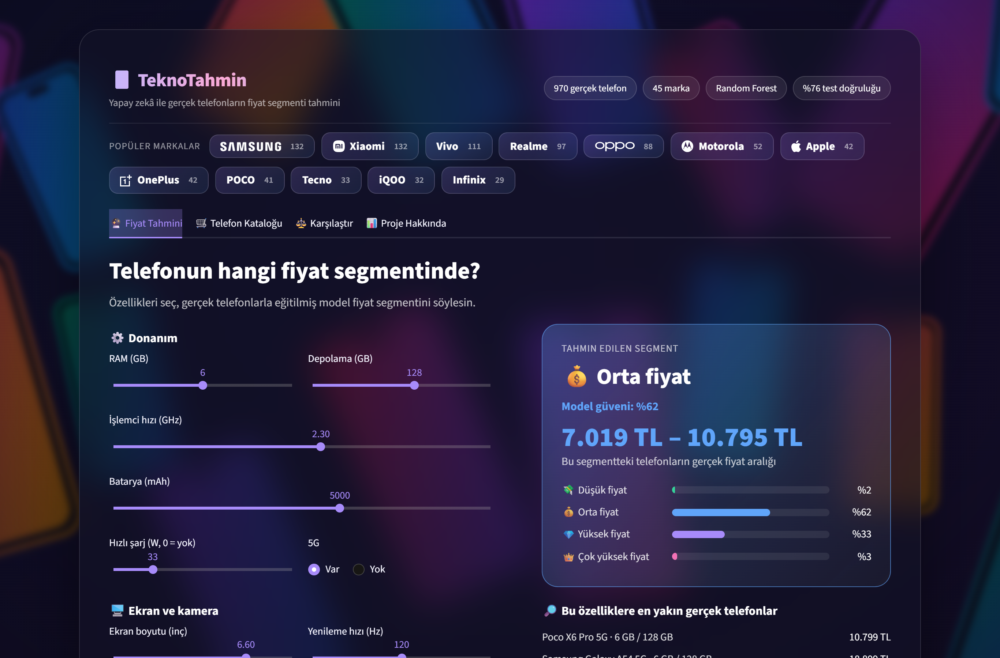
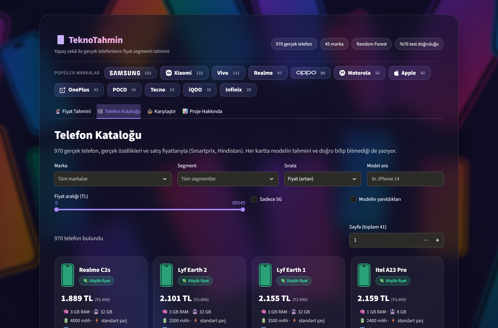
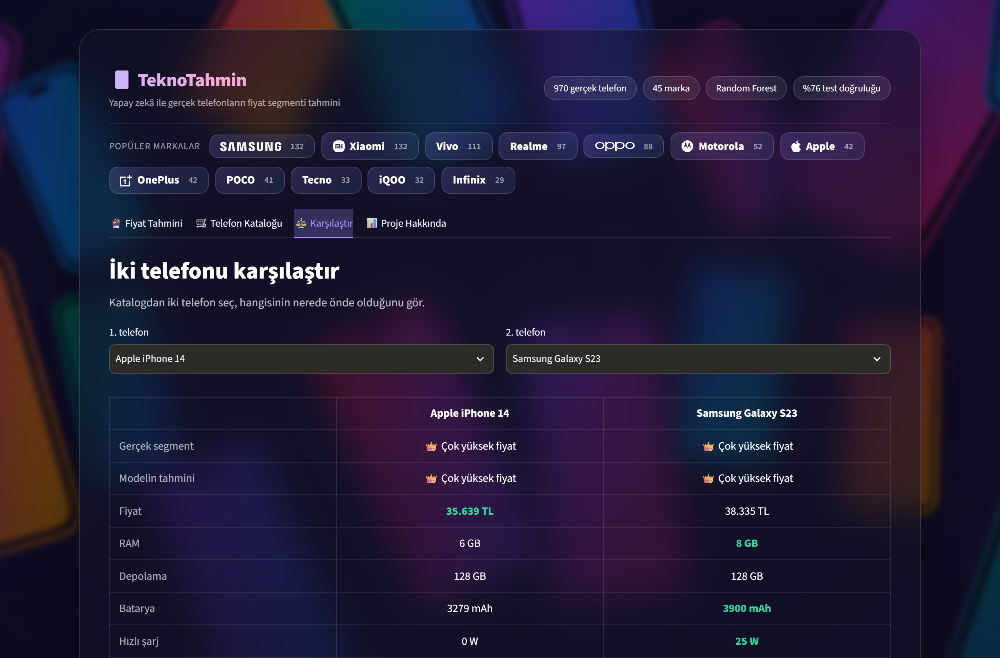
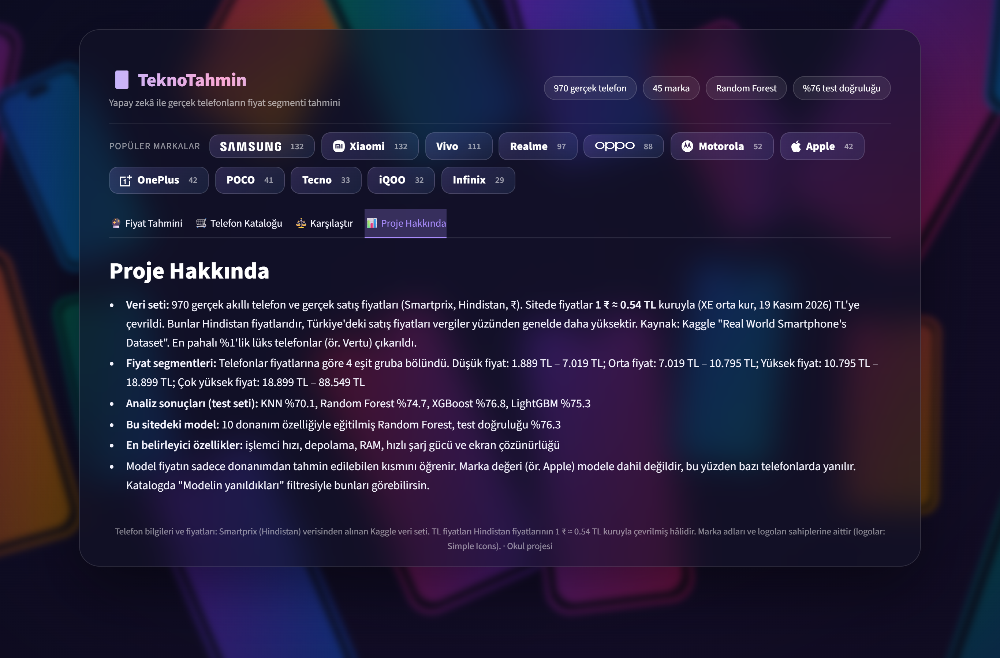

# Mobile Price Range Classification (Mobil Cihaz Fiyat Segmenti Tahmini)

Bu proje, akıllı telefonların ve mobil cihazların donanım mimarilerini, performans bileşenlerini ve teknik spesifikasyonlarını (RAM kapasitesi, batarya ömrü, ekran çözünürlüğü, işlemci çekirdek sayısı, kamera özellikleri ve bağlantı teknolojileri vb.) derinlemesine analiz ederek cihazları en uygun fiyat segmentine yerleştiren uçtan uca bir Makine Öğrenmesi (Machine Learning) çözümüdür.

---

## 📌 Problem Tanımı

Günümüz mobil teknoloji pazarında hem üretici çeşitliliği hem de donanım kombinasyonları üstel bir hızla artmaktadır. Tüketiciler için bir cihazın sunduğu teknik özelliklerin fiyatını hak edip etmediğini anlamak; üreticiler, distribütörler ve perakendeciler için ise yeni piyasaya sürülecek bir cihazın donanım maliyetine ve rekabet koşullarına göre hangi fiyat bandında konumlandırılması gerektiğini belirlemek oldukça karmaşık ve hata payı yüksek bir süreçtir.

Geleneksel kural tabanlı fiyatlandırma yaklaşımları, donanım bileşenleri arasındaki doğrusal olmayan (non-linear) ilişkileri yakalamakta yetersiz kalmaktadır. Bu projede, çok boyutlu teknik parametreleri işleyerek gizli örüntüleri ortaya çıkaran mesafeye dayalı (**K-Nearest Neighbors**) ve topluluk öğrenmesi tabanlı (**Random Forest**) sınıflandırma algoritmaları kullanılmış; ek karşılaştırma olarak **XGBoost** ve **LightGBM** modelleri de denenmiştir.

---

## 🎯 Projenin Amacı

- **Yüksek Doğruluklu Segmentasyon:** Mobil cihazların 20 teknik özelliğini işleyerek onları **4 temel fiyat segmentine** (`0: Düşük / Giriş Segmenti`, `1: Orta Segment`, `2: Yüksek / Üst-Orta Segment`, `3: Çok Yüksek / Amiral Gemisi`) minimum hata payı ve maksimum genelleme yeteneği ile atamak.
- **Algoritmik Performans Karşılaştırması:** Öklid mesafesi tabanlı çalışan **KNN** algoritması ile birden fazla karar ağacının oylamasıyla (Bagging) çalışan **Random Forest** modelinin eğitim sürelerini, aşırı öğrenmeye (overfitting) karşı dirençlerini ve tahmin başarımlarını karşılaştırmalı olarak analiz etmek.
- **Özellik Etki ve Korelasyon Analizi:** Fiyat kategorisini belirlemede en yüksek ağırlığa sahip olan kritik donanım bileşenlerini (örneğin RAM miktarı, batarya kapasitesi, piksel yoğunluğu vb.) istatistiksel olarak tespit etmek ve donanım-fiyat ilişkisini şeffaf hale getirmek.

---

## 👤 Hedef Kullanıcılar

- **Mobil Cihaz Üreticileri & Ürün Yöneticileri (PM):** Ar-Ge aşamasındaki veya yeni piyasaya sürülecek bir cihazın donanım konfigürasyonuna göre hedef pazar fiyat bandını belirlemek ve maliyet-performans optimizasyonu yapmak isteyen ekipler.
- **E-Ticaret & Teknoloji Karşılaştırma Platformları:** Ürün kataloglarına eklenen binlerce cihazı manuel müdahale olmadan otomatik olarak fiyat-performans kategorilerine ayırmak ve kullanıcı arama/filtreleme algoritmalarını iyileştirmek isteyen yazılım ve veri ekipleri.
- **Veri Bilimi Öğrencileri ve Makine Öğrenmesi Araştırmacıları:** Çok sınıflı sınıflandırma (Multi-class Classification) problemlerinde özellik ölçeklendirmenin etkisini, hiperparametre optimizasyonunu ve farklı algoritma paradigmalarının kıyaslanmasını incelemek isteyen geliştiriciler.

---

## 📁 Veri Seti

Projede iki veri seti kullanıldı. İlk analiz sentetik Kaggle veri setiyle yapıldı, ardından aynı adımlar gerçek telefon verisiyle tekrarlandı (v2). Değişikliğin nedeni en alttaki **🔄 Veri Setini Neden Değiştirdik?** bölümünde anlatılıyor.

### 1. Eski veri seti (v1, sentetik)

| Bilgi | Değer |
| :--- | :--- |
| **Kaynak** | [Kaggle – *Mobile Price Classification*](https://www.kaggle.com/datasets/iabhishekofficial/mobile-price-classification) |
| **Dosya** | `train.csv` |
| **Satır / Sütun** | 2000 satır, 21 sütun (20 özellik + 1 hedef) |
| **Eksik Değer** | Yok |
| **Hedef Değişken** | `price_range` (0, 1, 2, 3) |
| **Sınıf Dağılımı** | Dengeli – her sınıfta 500 örnek |

**Önemli değişkenler:** `battery_power` (mAh), `ram` (MB), `px_height` / `px_width` (piksel çözünürlüğü), `int_memory` (GB), `clock_speed` (GHz), `n_cores`, `fc` / `pc` (ön/arka kamera MP), `four_g`, `three_g`, `wifi`, `blue`, `dual_sim`, `touch_screen` (0/1).

### 2. Yeni veri seti (v2, gerçek telefonlar)

| Bilgi | Değer |
| :--- | :--- |
| **Kaynak** | Kaggle – *Real World Smartphone's Dataset* (Smartprix verisi), kullanılan kopya: [Hugging Face](https://huggingface.co/datasets/jason1966/abhijitdahatonde_real-world-smartphones-dataset) |
| **Dosya** | `gercek_telefonlar.csv` |
| **Satır / Sütun** | 980 gerçek telefon, 22 sütun (marka, model, fiyat ve donanım özellikleri) |
| **Fiyat** | Gerçek satış fiyatı, Hindistan Rupisi (₹) |
| **Hedef Değişken** | `price_range`: fiyata göre 4 eşit gruba (çeyrek) bölünerek oluşturuldu |
| **Temizleme** | En pahalı %1'lik 10 lüks telefon çıkarıldı, birkaç eksik değer medyanla dolduruldu, analizde 970 telefon kaldı |

**Kullanılan özellikler (16):** `ram_capacity`, `internal_memory`, `battery_capacity`, `processor_speed`, `num_cores`, `screen_size`, `refresh_rate`, `resolution_height`, `resolution_width`, `primary_camera_rear`, `primary_camera_front`, `num_rear_cameras`, `5G_or_not`, `fast_charging_available`, `fast_charging`, `extended_memory_available`.

---

## 🔍 Kapsam ve Kapsam Dışı

### ✅ Kapsam İçi
- **Veri Ön İşleme ve Temizleme:** Veri setindeki eksik değerlerin (`Null`/`NaN`) ve tekrarlı satırların tespiti, mantıksal tutarlılık kontrolleri (sıfır ekran genişliği/yüksekliği ve sıfır piksel değerleri) ve boxplot ile aykırı değer (`Outlier`) incelemesi.
- **Keşifçi Veri Analizi (EDA):** Sınıf dağılımı, temel istatistikler ve özellikler arası korelasyon (`Multicollinearity`) ısı haritası.
- **Özellik Ölçeklendirme (Feature Scaling):** KNN için ölçeklendirmesiz, `StandardScaler` ve `MinMaxScaler` dönüşümlerinin karşılaştırılması.
- **Model Eğitimi ve Optimizasyonu:** KNN ve Random Forest modellerinin `Train-Test Split` (%80/%20, stratified) ve 5-fold `Cross-Validation` ile eğitilmesi; `GridSearchCV` ile hiperparametre optimizasyonu.
- **Ek Model Karşılaştırması:** `XGBoost` ve `LightGBM`.
- **Kapsamlı Performans Değerlendirmesi:** `Accuracy`, `Precision`, `Recall`, `F1-Score`, `Confusion Matrix`, öğrenme eğrisi, eğitim/test skoru farkı (overfitting kontrolü) ve hata analizi.
- **Özellik Önemi Analizi:** Random Forest `Feature Importance` skorları ve yalnızca en önemli 5 özellikle yeniden eğitilen modelin karşılaştırılması.

### ❌ Kapsam Dışı
- Canlı/gerçek zamanlı piyasa fiyat verilerinin (TL, USD, EUR) e-ticaret sitelerinden web scraping yöntemiyle anlık olarak çekilmesi.
- Kur dalgalanmaları, vergi oranları veya marka algısı (Apple, Samsung vb. marka değeri) gibi donanım dışı makroekonomik faktörlerin modele dahil edilmesi.
- Derin Öğrenme (Yapay Sinir Ağları / YSA) mimarilerinin veya büyük dil modellerinin projeye entegrasyonu.
- Canlı sunucu üzerinde çalışan REST API dağıtımı (FastAPI / Flask). *(Bunun yerine Streamlit ile bir tanıtım web arayüzü yapıldı, aşağıdaki **🌐 Web Arayüzü** bölümüne bakın.)*
- İkinci el veya yenilenmiş (refurbished) cihazların kozmetik hasar, pil sağlığı ve kullanım süresine dayalı fiyatlandırması.

---

## 👥 Ekip ve Roller

| Üye | Rolü ve Sorumlulukları |
| :--- | :--- |
| **Mert Ali Dağ** | **Kodlama & Model Mimarisi:** Veri ön işleme boru hatlarının (pipeline) kurulması, KNN ve Random Forest algoritmalarının kodlanması, hiperparametre ayarlamaları ve model performans metriklerinin teknik analizi. |
| **Gürkan Tural** | **Veri Analisti:** Ham veri setinin temizlenmesi, keşifçi veri analizi (EDA), donanım değişkenleri arasındaki istatistiksel korelasyonların incelenmesi ve bulguların anlaşılır grafiklerle görselleştirilmesi. |
| **Efe Erdem** | **Araştırmacı Veri Analizi:** Sınıflandırma problemine yönelik literatürdeki benzer çalışmaların ve rakip yaklaşımların araştırılması, elde edilen deneysel sonuçların raporlanması ve proje dokümantasyonunun oluşturulması. |

---

## 🛠️ Kullanılan Teknolojiler ve Algoritmalar

### 🐍 Programlama Dili & Geliştirme Ortamı
- **Python 3.x:** Zengin veri bilimi ekosistemi ve okunabilir sözdizimi nedeniyle projenin ana geliştirme dili olarak tercih edilmiştir.
- **VS Code / Jupyter Notebook:** İnteraktif veri keşfi, adım adım kod testleri ve görselleştirme çıktılarının anlık takibi için hibrit çalışma ortamı olarak kullanılmıştır.

### 📚 Temel Veri Bilimi Kütüphaneleri
- **Pandas & NumPy:** Tablosal veri manipülasyonu, eksik veri yönetimi, filtreleme ve çok boyutlu matris/vektör hesaplamaları.
- **Matplotlib & Seaborn:** Histogram, kutu grafikleri (`Boxplot`), korelasyon ısı haritası (`Heatmap`), `Confusion Matrix`, öğrenme eğrisi ve özellik önemi grafikleri.
- **XGBoost & LightGBM:** Gradient Boosting tabanlı ek karşılaştırma modelleri.
- **Joblib:** Eğitilen en iyi modelin `.pkl` dosyası olarak kaydedilmesi.

### 🤖 Makine Öğrenmesi Algoritmaları (Scikit-Learn)
- **K-Nearest Neighbors (KNN):**
  - **Çalışma Prensibi:** Yeni bir veri noktasının, özellik uzayındaki en yakın $K$ adet komşusunun çoğunluk sınıfına göre etiketlendiği parametrik olmayan, mesafe tabanlı (Öklid mesafesi) sınıflandırma algoritmasıdır.
  - **Veri Hazırlığı:** Farklı birimlere sahip donanım özelliklerinin (örn. mAh ve GHz) mesafe hesabını bozmaması için veriler `StandardScaler` / `MinMaxScaler` ile aynı ölçeğe indirgenmiştir. Ölçekleyici yalnızca eğitim verisine `fit` edilerek veri sızıntısı önlenmiştir.
  - **Hiperparametre Optimizasyonu:** 1–29 arası tek $K$ değerleri 5-fold cross-validation ile (`GridSearchCV` + `Pipeline`) denenerek en ideal komşu sayısı belirlenmiştir.
- **Random Forest (Rastgele Orman):**
  - **Çalışma Prensibi:** Veri setinin farklı alt kümeleri üzerinde eğitilen çok sayıda karar ağacının (Decision Trees) tahminlerini birleştirerek (Bagging / Ensemble Learning) nihai kararı veren güçlü bir sınıflandırma algoritmasıdır.
  - **Veri Hazırlığı:** Dallanma mantığı eşik değerlere dayandığı için değişken ölçeklendirmesine ihtiyaç duymadan ham sayısal değerlerle eğitilmiştir.
  - **Hiperparametre Optimizasyonu:** `GridSearchCV` ile `n_estimators`, `max_depth` ve `min_samples_split` kombinasyonları taranmıştır.
  - **Açıklanabilirlik (`Feature Importance`):** Her bir donanım özelliğinin ağaçlardaki safsızlığı (Gini Impurity) ne kadar azalttığı hesaplanarak, fiyat segmentini belirleyen en kritik bileşenler önem sırasına göre listelenmiştir.

---

## 📊 Sistem Mimarisi ve UML Diyagramları

Projede yazılımın yapısal tasarımını standartlaştırmak, veri işleme adımlarının mantıksal akışını netleştirmek ve kullanıcı etkileşimlerini modellemek amacıyla üç temel UML diyagramından yararlanılmıştır:

### 1. Sınıf Diyagramı (Class Diagram)
https://drive.google.com/file/d/1wXQ1T78jBfvHYGDIdV7gmmJJrdiNILgY/view

Sistemin **statik (değişmeyen) yapısal iskeletini** ortaya koyar. Kodlama mimarisinde yer alan veri yükleme, ön işleme, model eğitimi ve değerlendirme sınıflarını; bu sınıfların sahip olduğu nitelikleri (değişken/alan) ve gerçekleştirdikleri operasyonları (metot/fonksiyon) modüler kutular halinde tanımlar. Sınıflar arasındaki kalıtım, bağımlılık ve sahiplik ilişkilerini oklarla göstererek kodun sürdürülebilirliğini ve nesne yönelimli tasarım prensiplerine uygunluğunu belgeler.

### 2. Aktivite Diyagramı (Activity Diagram)
https://drive.google.com/file/d/1sY0KN6_H-XqaEXJlFyjsmkQT3QytY3K5/view

Sistemin uçtan uca **dinamik iş akışını** adım adım görselleştirir. Ham veri setinin sisteme alınmasından başlayarak veri temizleme, eksik değer kontrolü, ölçeklendirme karar noktaları (algoritma seçimine göre dallanma), model eğitimi ve performans metriklerinin raporlanmasına kadar tüm süreçleri akış şeması mantığıyla ifade eder.

### 3. Kullanım Senaryosu Diyagramı (Use Case Diagram)
https://drive.google.com/file/d/1OTLalFktwd552cqEhQhItV4Ar7u9I8-s/view

Sistemi dışarıdan kullanan **aktörleri** (veri analisti, araştırmacı, son kullanıcı vb.) ve bu aktörlerin sistem üzerinde gerçekleştirebileceği **temel işlevleri** (veri yükleme, model çalıştırma, tahmin sonucu görüntüleme, rapor inceleme vb.) tanımlar.

---

## 📂 Klasör Yapısı

### 📚 Araştırma ve Dokümantasyon
| Dosya | Açıklama |
| :--- | :--- |
| `README.md` | Proje tanıtımı ve sonuçlar |
| `Literatur_Arastirmasi.md` | Benzer çalışmalar ve literatür taraması |
| `Proje İçin Kullanılan Veri Seti Örneği` | Veri setinden örnek kayıtlar |

### 🧹 Veri Analizi ve Ön İşleme
| Dosya | Açıklama |
| :--- | :--- |
| `veri_inceleme_eda_hazir.ipynb` | Keşifçi veri analizi (EDA) notebook'u |
| `Veri_On_Isleme.md` | Ön işleme adımlarının açıklaması |
| `Veri_seti_hata_ayıklama_raporu.md` | Veri kalitesi / hata ayıklama raporu |

### 🤖 Modelleme
| Dosya | Açıklama |
| :--- | :--- |
| `proje.ipynb` | KNN, Random Forest, XGBoost ve LightGBM kodu |
| `mobil_fiyat_projesi.py` | Aynı kodun tek dosyalık Python sürümü (`python mobil_fiyat_projesi.py`) |
| `en_iyi_model_rf.pkl` | Kaydedilen Random Forest modeli |
| `scaler.pkl` | Kaydedilen StandardScaler |

### 📈 Sonuçlar
| Dosya | Açıklama |
| :--- | :--- |
| `sonuclar.csv` | Test seti model karşılaştırma tablosu |
| `cv_sonuclari.csv` | 5-fold cross-validation sonuçları |
| `grafikler/` | Tüm grafikler: sınıf dağılımı, korelasyon, boxplot, confusion matrix, feature importance, KNN k grafiği, öğrenme eğrisi |

### 📦 Veri
| Dosya | Açıklama |
| :--- | :--- |
| `train.csv` | Veri seti (2000 satır, 21 sütun), kaynak: [Kaggle – Mobile Price Classification](https://www.kaggle.com/datasets/iabhishekofficial/mobile-price-classification) |

### 🌐 Web Arayüzü (`web_arayuzu/`)
| Dosya | Açıklama |
| :--- | :--- |
| `app.py` | TeknoTahmin web sitesinin Streamlit kodu |
| `requirements.txt` | Sitenin ihtiyaç duyduğu kütüphaneler |
| `Dockerfile` | Sitenin Render'da Docker ile çalıştırılması için kurulum dosyası |
| `.streamlit/config.toml` | Koyu tema ayarları |
| `logolar.py` | Marka logoları (Simple Icons, tek renk SVG) |
| `gercek_telefonlar.csv` | Sitedeki modelin eğitildiği gerçek telefon verisi |

### 📱 Gerçek Telefon Verisiyle Analiz (v2)
| Dosya | Açıklama |
| :--- | :--- |
| `gercek_telefonlar.csv` | 980 gerçek akıllı telefon ve gerçek fiyatları (Smartprix, Hindistan ₹), kaynak: Kaggle – Real World Smartphone's Dataset |
| `gercek_telefon_projesi.py` / `PROJE_gercek.ipynb` | Aynı analiz adımlarının gerçek veriyle yapılmış hâli (20 bölüm) |
| `sonuclar_gercek.csv`, `cv_sonuclari_gercek.csv` | Gerçek veriyle model sonuçları |
| `grafikler_gercek/` | Gerçek veriyle üretilen grafikler |

---

## ⚙️ Kurulum ve Çalıştırma

```bash
# 1. Depoyu klonlayın
git clone https://github.com/mertalidag14/Mobile-Price-Range.git
cd Mobile-Price-Range

# 2. Gerekli kütüphaneleri kurun
python -m pip install pandas numpy scikit-learn matplotlib seaborn xgboost lightgbm joblib notebook

# 3a. Eski (sentetik) veri setiyle analiz (train.csv aynı klasörde olmalı)
jupyter notebook proje.ipynb          # ya da: python mobil_fiyat_projesi.py

# 3b. Gerçek telefon verisiyle analiz (v2, gercek_telefonlar.csv aynı klasörde olmalı)
jupyter notebook PROJE_gercek.ipynb   # ya da: python gercek_telefon_projesi.py

# 4. Web sitesini bilgisayarda açmak için
cd web_arayuzu
python -m pip install -r requirements.txt
streamlit run app.py
```

VS Code kullanılıyorsa notebook dosyası açılıp **Run All** ile çalıştırılabilir.

---

## 📈 Sonuçlar (v1, sentetik veri seti)

Gerçek telefon verisiyle elde edilen sonuçlar için aşağıdaki **📱 Gerçek Telefon Verisiyle Analiz (v2)** bölümüne bakın.

Test seti: 400 örnek (%20, stratified). Metrikler ağırlıklı (weighted) ortalamadır.

| Model | Accuracy | Precision | Recall | F1-Score |
| :--- | :---: | :---: | :---: | :---: |
| KNN (k=5, ölçeklendirmesiz) | **0.9350** | **0.9346** | **0.9350** | **0.9347** |
| KNN (k=29, StandardScaler) | 0.6600 | 0.6688 | 0.6600 | 0.6623 |
| Random Forest | 0.8825 | 0.8818 | 0.8825 | 0.8819 |

### 5-Fold Cross-Validation (Accuracy)

Tek bir test bölmesine bağlı kalmamak için tüm modeller 2000 örnek üzerinde 5-fold CV ile de değerlendirildi.

| Model | CV Ortalama | CV Std |
| :--- | :---: | :---: |
| KNN (StandardScaler, CV ile seçilen k) | 0.6200 | ±0.0146 |
| Random Forest | 0.8755 | ±0.0099 |
| **XGBoost** | **0.9130** | ±0.0129 |
| LightGBM | 0.9085 | ±0.0096 |

Gradient Boosting modelleri (XGBoost, LightGBM) Random Forest'ı yaklaşık 3–4 puan geçti. Standart sapmaların düşük olması sonuçların kararlı olduğunu gösteriyor.

### Öne Çıkan Bulgular
- **En yüksek başarı ölçeklendirmesiz KNN ile elde edildi** (%93,5). Cross-validation'da XGBoost %91,3, LightGBM %90,85, Random Forest %87,55 aldı. Ölçeklendirilmiş KNN ise %66'da kaldı.
- **Ölçeklendirme KNN'i bozdu (beklenmedik bulgu):** ölçeklendirmesiz veride `ram` (250–4000 aralığı) mesafe hesabına hâkim oluyor ve RAM fiyatı en iyi açıklayan özellik olduğu için KNN çok başarılı oluyor. StandardScaler tüm özelliklere eşit ağırlık verince fiyatla ilgisiz 16 özellik mesafeyi gürültüyle dolduruyor ve başarı %50'ye düşüyor.
- **RAM açık ara en belirleyici özellik:** fiyat segmentiyle korelasyonu **0,92**, Random Forest önem skoru yaklaşık **0,48**. Ardından `battery_power` (0,20), `px_width` (0,17) ve `px_height` (0,15) geliyor. Diğer özelliklerin fiyatla korelasyonu 0,05'in altında.
- **Hatalar yalnızca komşu segmentler arasında:** Random Forest'ta 0 ile 3 hiç karışmadı. En çok karışan çift 1↔2 oldu (24 hata).
- **KNN'in düşük kalmasının nedeni:** fiyatla ilişkisiz 16 özellik mesafe hesabını gürültüyle dolduruyor. CV F1 skoru k büyüdükçe artıp k≈19'dan sonra 0,59 civarında sabitlendi.
- **Overfitting:** Random Forest eğitim skoru %100, CV skoru yaklaşık %87,5. Öğrenme eğrisi hâlâ yükseldiği için daha fazla veriyle başarının artması bekleniyor.
- **Veri seti tamamen dengeli:** her segmentte 500 örnek.

### Hipotezlerin Değerlendirilmesi
| Hipotez | Sonuç | Gerekçe |
| :--- | :---: | :--- |
| H1: Teknik özelliklerle 4 segment sınıflandırılabilir | ✅ Kabul | Random Forest %88,25 doğruluk |
| H2: KNN ve RF arasında belirgin fark var | ✅ Kabul | Ölçeklendirmeye bağlı: ölçeklendirmesiz KNN RF'den 5 puan iyi, ölçeklendirilmiş KNN 22 puan kötü |
| H3: Ölçeklendirme KNN'i olumlu etkiler | ❌ Ret | Ölçeklendirmesiz %93,5, StandardScaler %50, MinMaxScaler %42,5 (k=5) |
| H4: RAM, batarya, çözünürlük önemli | ✅ Kabul | Feature Importance ilk 4 sırası |


---

## 📱 Gerçek Telefon Verisiyle Analiz (v2)

Kaggle'ın sentetik veri setine ek olarak, model **980 gerçek telefonun** gerçek satış fiyatlarıyla da denendi
(Smartprix, Hindistan). En pahalı %1'lik lüks telefonlar (ör. Vertu) çıkarıldı, kalan **970 telefon** fiyatlarına göre
4 eşit segmente bölündü: Düşük ₹3.499–12.999, Orta ₹12.999–19.990, Yüksek ₹19.990–34.999, Çok yüksek ₹34.999–163.980.
Modelde 16 donanım özelliği kullanıldı (RAM, depolama, batarya, işlemci hızı, ekran, kamera, 5G, hızlı şarj vb.).

| Model | Accuracy | Precision | Recall | F1-Score | 5-Fold CV |
| :--- | :---: | :---: | :---: | :---: | :---: |
| KNN (k=3, StandardScaler) | 0.7010 | 0.6982 | 0.7010 | 0.6963 | 0.6186 |
| Random Forest | 0.7474 | 0.7441 | 0.7474 | 0.7430 | **0.7062** |
| **XGBoost** | **0.7680** | **0.7651** | **0.7680** | **0.7636** | 0.6794 |
| LightGBM | 0.7526 | 0.7495 | 0.7526 | 0.7462 | 0.6804 |

**Bulgular:**
- Gerçek veride başarı sentetik veriye göre düşük (%94 yerine %75 civarı). Bunun nedeni gerçek fiyatın marka değeri,
  tasarım ve pazarlama gibi donanım dışı etkenlere de bağlı olması.
- Sentetik veride RAM tek başına belirleyiciydi. Gerçek veride ise **işlemci hızı, depolama, RAM, hızlı şarj gücü ve
  ekran çözünürlüğü** birlikte önemli.
- Ölçeklendirme bu kez KNN'e yardımcı oldu (F1: 0.64 → 0.66). Çünkü gerçek veride tek bir özellik baskın değil.
- Hatalar yine çoğunlukla komşu segmentler arasında (ör. Düşük ↔ Orta).

---

## 🚀 Proje Durumu ve Gelecek Hedefleri

### ✅ Tamamlananlar
- Keşifçi veri analizi, veri kalitesi ve mantıksal tutarlılık kontrolleri
- KNN için ölçeklendirme karşılaştırması (ölçeklendirmesiz / StandardScaler / MinMaxScaler)
- KNN ve Random Forest modellerinin `GridSearchCV` ile optimize edilmesi
- `XGBoost` ve `LightGBM` ile ek model karşılaştırması
- 5-fold cross-validation, öğrenme eğrisi ve overfitting kontrolü
- Feature Importance analizi ve en önemli 5 özellikle model testi
- Hata analizi ve eğitim süresi karşılaştırması
- En iyi modelin `.pkl` olarak kaydedilmesi
- 980 gerçek telefonla aynı analizin tekrarlanması (v2)
- **TeknoTahmin** web arayüzü (Streamlit + Docker, Render üzerinde yayında)

### 🔭 Gelecek Hedefleri
- **Ek Algoritmalar:** `CatBoost` ve Destek Vektör Makinelerinin (`SVM`) sisteme dahil edilmesi.
- **RandomizedSearchCV:** Daha geniş parametre uzaylarında daha hızlı arama.

---

## 🌐 Web Arayüzü: TeknoTahmin

Projenin gerçek telefon verisiyle eğitilen modeli **TeknoTahmin** adlı bir Streamlit web sitesine dönüştürüldü
(canlı: **https://teknotahmin-0iji.onrender.com**). Sitede 4 sekme var:

- **🔮 Fiyat Tahmini:** RAM, depolama, işlemci, batarya, ekran, kamera, 5G ve hızlı şarj seçilince fiyat segmenti,
  model güveni, segmentin gerçek fiyat aralığı ve bu özelliklere en yakın gerçek telefonlar gösterilir.
- **🛒 Telefon Kataloğu:** 970 gerçek telefon, gerçek fiyatları ve marka logolarıyla mağaza kartları halinde listelenir.
  Marka, segment, fiyat aralığı, 5G filtreleri, sıralama, arama ve "modelin yanıldıkları" filtresi vardır.
- **⚖️ Karşılaştır:** İki gerçek telefon yan yana karşılaştırılır (gerçek segment ve modelin tahmini dahil).
- **📊 Proje Hakkında:** Model sonuçlarının özeti.

**Model:** 10 donanım özelliğiyle eğitilmiş Random Forest, test doğruluğu yaklaşık **%76**.

### 📸 Ekran Görüntüleri

**🔮 Fiyat Tahmini:** Özellikler seçilince fiyat segmenti, model güveni ve en yakın gerçek telefonlar


**🛒 Telefon Kataloğu:** 970 gerçek telefon, TL fiyatlar, marka logoları ve filtreler


**⚖️ Karşılaştır:** İki telefonun yan yana karşılaştırması


**📊 Proje Hakkında:** Veri seti, segmentler ve model sonuçlarının özeti


> **Not:** Fiyatlar Smartprix (Hindistan) verisindeki Hindistan Rupisi (₹) fiyatlarıdır. Sitede 1 ₹ ≈ 0,54 TL
> kuruyla (XE orta kur, 19 Kasım 2026) TL'ye çevrilerek gösterilir. Marka adları ve logoları
> sahiplerine aittir (logolar: Simple Icons).

**Bilgisayarda çalıştırma:**
```bash
cd web_arayuzu
python -m pip install -r requirements.txt
streamlit run app.py
```

**Yayınlama:** Site [Render](https://render.com) üzerinde ücretsiz planda Docker ile yayınlanır (Root Directory: `web_arayuzu`).


---

## 🔄 Veri Setini Neden Değiştirdik?

Projeye Kaggle'daki **Mobile Price Classification** veri setiyle başladık (eski veri seti: [Kaggle – Mobile Price Classification](https://www.kaggle.com/datasets/iabhishekofficial/mobile-price-classification)). Bu veri setiyle yapılan analiz (v1) projede olduğu gibi duruyor: `proje.ipynb`, `mobil_fiyat_projesi.py`, `train.csv`, `sonuclar.csv`, `grafikler/`.

Çalışma ilerledikçe bu veri setinin bazı sınırlarını fark ettik ve analizi gerçek telefon verisiyle tekrarladık (v2):

1. **Veri sentetik.** 2000 satırın hiçbiri gerçek bir telefon modeline karşılık gelmiyor. Telefonların marka ve model adı yok, bu yüzden sonuçları gerçek cihazlarla karşılaştıramıyorduk.
2. **Gerçek fiyat yok.** Hedef değişken sadece 0–3 arası bir etiket. Bir segmentin kaç lira olduğunu söylemek mümkün değildi.
3. **Sonuçlar gerçekçi değil.** Fiyat segmenti neredeyse tamamen RAM'e bağlı (korelasyon 0,92) ve modeller %93–94 gibi çok yüksek başarı veriyor. Gerçek piyasada fiyat tek bir özellikten bu kadar net tahmin edilemez.
4. **Güncel değil.** RAM en fazla 4 GB, batarya en fazla yaklaşık 2000 mAh. Bugünün telefonları (8 GB+ RAM, 5000 mAh) bu aralığın tamamen dışında kalıyor, bu yüzden model güncel bir telefon için anlamlı tahmin yapamıyordu.

**Yeni veri setiyle neler değişti?**
- 980 **gerçek** telefon, marka ve model adlarıyla birlikte, **gerçek satış fiyatlarıyla** kullanıldı.
- Segmentler gerçek fiyatlara göre 4 eşit gruba bölünerek oluşturuldu, böylece her segmentin fiyat aralığı belli.
- Başarı %94'ten yaklaşık **%75'e** düştü (en iyi: XGBoost %76,8). Bu düşüş beklenen bir sonuç: gerçek fiyat donanımın yanında marka değeri, tasarım ve pazarlama gibi modelin göremediği etkenlere de bağlı. Bu yüzden v2 sonuçları gerçek dünyayı daha dürüst yansıtıyor.
- En önemli özellikler artık tek başına RAM değil: **işlemci hızı, depolama, RAM, hızlı şarj gücü ve ekran çözünürlüğü** birlikte belirleyici.
- Web sitesi (TeknoTahmin) bu sayede gerçek telefonları, gerçek fiyatlarıyla gösterebiliyor.

Her iki analiz de aynı adımları (EDA, ölçeklendirme karşılaştırması, KNN, Random Forest, XGBoost, LightGBM, cross-validation, feature importance, hata analizi) izlediği için iki veri setinin sonuçları doğrudan karşılaştırılabilir.
