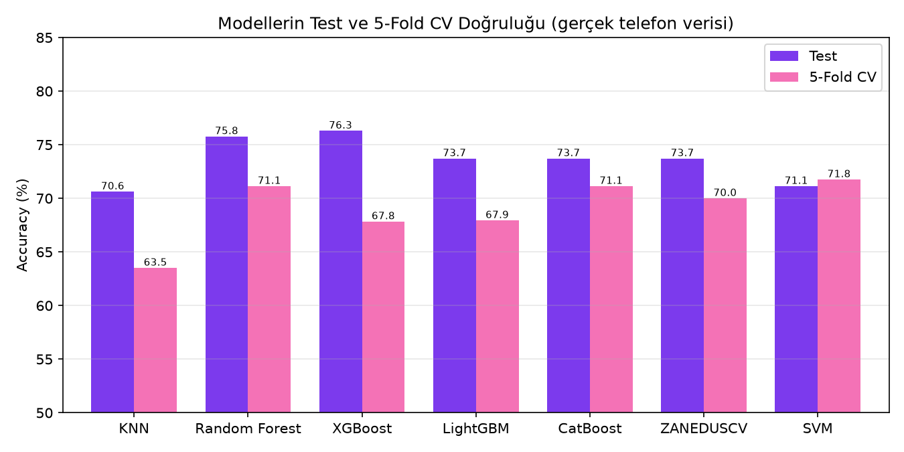
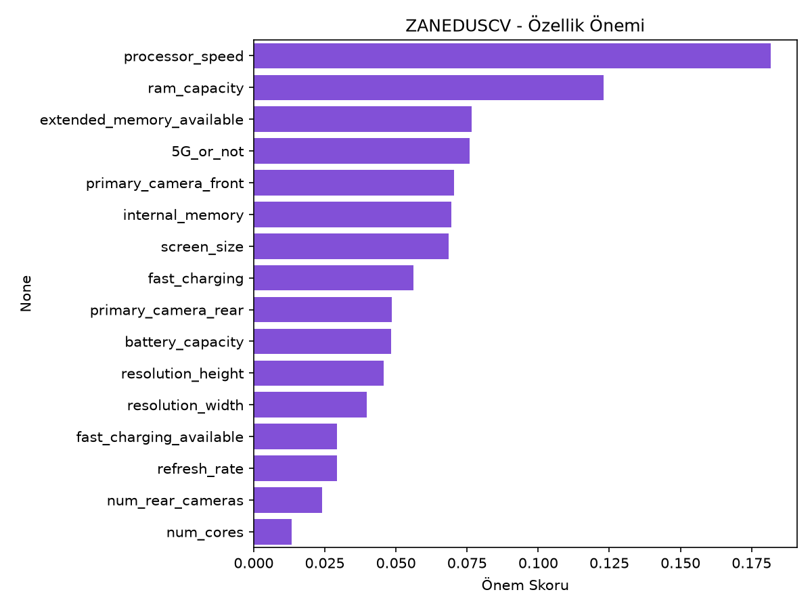
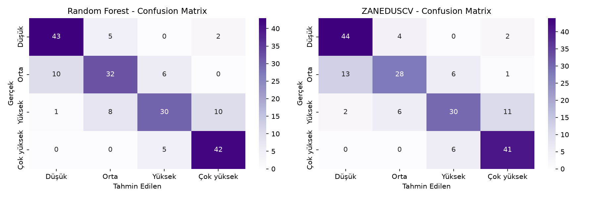
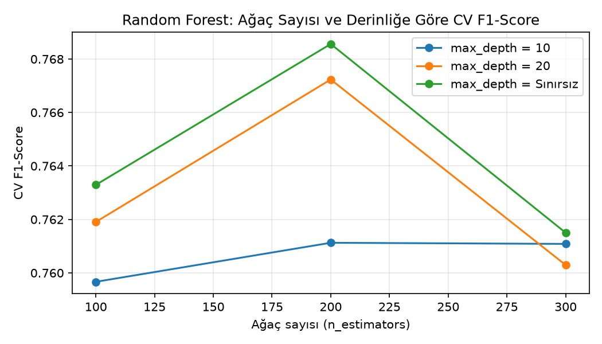
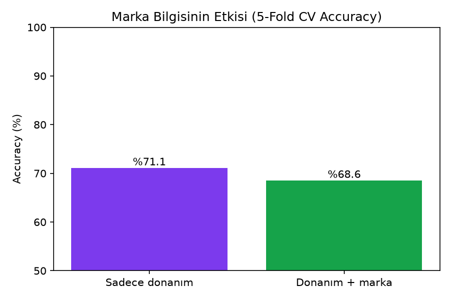
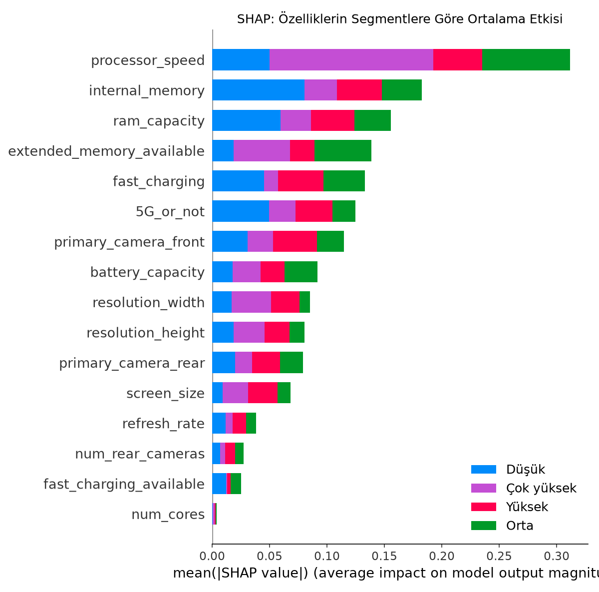
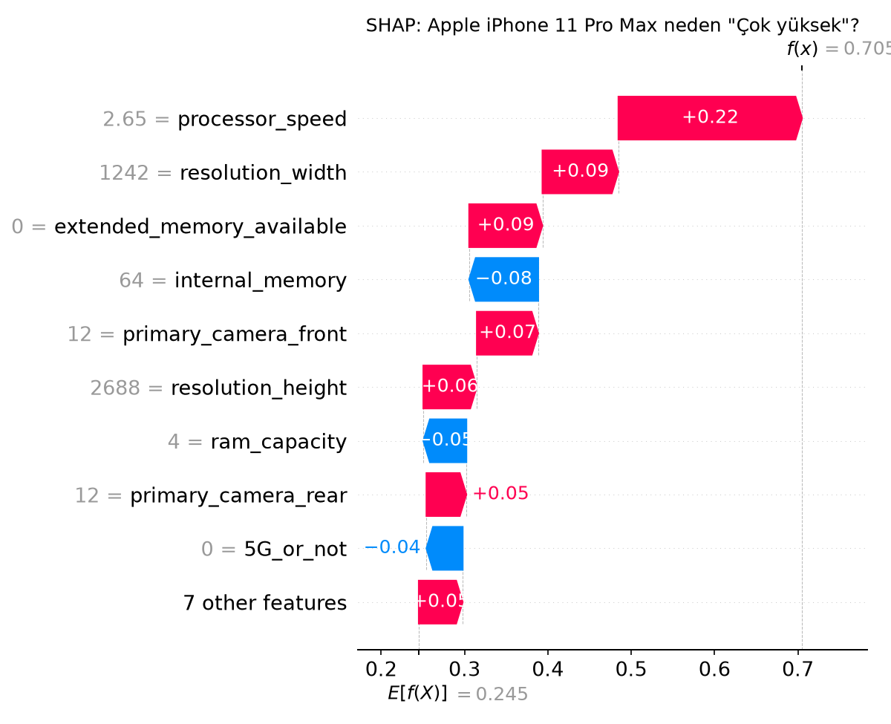

# Mobile Price Range – Telefon Fiyat Segmenti Tahmini

Bu projede bir telefonun donanım özelliklerine (RAM, depolama, batarya, işlemci, ekran, kamera gibi) bakarak hangi fiyat grubunda olduğunu tahmin etmeye çalışıyoruz. Bunun için makine öğrenmesi modelleri kuruyor, birbirleriyle karşılaştırıyor ve en iyi çalışanı **TeknoTahmin** adında bir web sitesine koyuyoruz.

🌐 Site: **https://teknotahmin-0iji.onrender.com**

🔗 **Bağlantılı proje: [ZANEDUSCV](https://github.com/mertalidag14/ZANEDUSCV).** Karşılaştırdığımız modellerden biri kendi yazdığımız algoritma. ZANEDUSCV, sadece NumPy ile sıfırdan yazdığımız, eğik bölmeli ve lineer yapraklı bir gradient boosting algoritması. Bu projede onu hem analizde diğer modellerle yarıştırıyoruz hem de sitedeki model seçiciye ekliyoruz.

---

## 📌 Problem

Bugün piyasada yüzlerce marka ve binlerce telefon modeli var. Her telefonun RAM'i, depolaması, işlemcisi, bataryası, ekranı ve kamerası farklı, bu özelliklerin birleşimi de çok fazla. Bu yüzden bir telefona bakıp "bu özellikler bu fiyatı hak ediyor mu?" sorusunu cevaplamak kolay değil.

Bu sorun iki taraf için de var:
- **Telefon alan kişi için:** Baktığı telefonun özelliklerine göre pahalı mı, uygun mu olduğunu anlamak zor. Aynı fiyata daha iyi özellikli bir telefon olabilir.
- **Üretici ve satıcılar için:** Yeni çıkacak bir telefonu, içindeki donanıma ve rakiplerine göre hangi fiyat aralığına koyacaklarına karar vermek karmaşık ve hata yapmaya açık.

Basit kurallarla da bu iş çözülmüyor. "RAM'i 8 GB'tan fazlaysa pahalıdır" gibi tek bir kural koyamıyoruz, çünkü özellikler birbirini etkiliyor. Mesela 8 GB RAM'li ucuz telefonlar da var, 6 GB RAM'li pahalı telefonlar da. Fiyat birden fazla özelliğin birlikte etkisiyle oluşuyor ve bu ilişki düz bir çizgi gibi değil.

Biz bu soruyu makine öğrenmesiyle çözmeye çalışıyoruz. Model binlerce telefonun özelliklerine ve fiyatlarına bakarak hangi özelliklerin pahalı telefona işaret ettiğini kendi kendine öğreniyor, sonra hiç görmediği bir telefon için tahmin yapıyor. Ana modellerimiz mesafeye dayalı çalışan **KNN** ve birçok karar ağacının oylamasıyla çalışan **Random Forest**. Karşılaştırma için **XGBoost** ve **LightGBM** de deniyoruz.

---

## 🎯 Projenin Amacı

- **Telefonları 4 fiyat segmentine ayırmak:** Telefonun teknik özelliklerine bakarak onu `0: Düşük (giriş seviyesi)`, `1: Orta`, `2: Yüksek (üst-orta)` ya da `3: Çok yüksek (amiral gemisi)` segmentine olabildiğince doğru yerleştirmek. Model sadece eğitimde gördüğü telefonlarda değil, hiç görmediği telefonlarda da iyi çalışmalı.
- **Algoritmaları karşılaştırmak:** En yakın komşulara bakan **KNN** ile çok sayıda karar ağacını birleştiren **Random Forest**'ı yan yana koymak. Hangisi daha doğru tahmin ediyor, hangisi veriyi ezberlemeye (overfitting) daha yatkın, hangisi daha hızlı eğitiliyor, bunlara bakmak. XGBoost ve LightGBM'i de bu karşılaştırmaya eklemek.
- **Ölçeklendirmenin etkisini görmek:** KNN mesafe hesapladığı için özelliklerin birimleri (mAh, GHz, GB) sonucu etkileyebiliyor. Verileri ölçeklendirmenin KNN'i iyileştirip iyileştirmediğini test etmek.
- **Fiyatı en çok neyin belirlediğini bulmak:** Fiyat segmentini belirlemede en çok ağırlığı olan donanım özelliklerini (RAM, işlemci, depolama, ekran çözünürlüğü, batarya, hızlı şarj gibi) istatistiksel olarak bulmak ve donanım ile fiyat arasındaki ilişkiyi açıkça göstermek.
- **Sentetik veri ile gerçek veriyi karşılaştırmak:** Aynı adımları önce hazır (sentetik) veriyle, sonra gerçek telefonlarla yapıp sonuçların ne kadar değiştiğini görmek.
- **Modeli herkesin kullanabileceği hâle getirmek:** En iyi modeli bir web sitesine (TeknoTahmin) koyup, telefonunun adını yazan ya da özelliklerini seçen herkesin fiyat segmentini görebilmesini sağlamak.

---

## 👤 Kimler İşine Yarar?

- **Telefon almak isteyenler:** Baktığı telefonun özelliklerinin fiyatını hak edip etmediğini görebilir. Sitede telefonları karşılaştırıp aynı fiyat grubundaki diğer telefonlara da bakabilir.
- **Telefon üreticileri ve ürün ekipleri:** Geliştirdikleri ya da yeni çıkaracakları bir telefonun donanımına göre hangi fiyat aralığına uygun olduğunu görüp fiyat-performans dengesini ayarlayabilir.
- **Alışveriş ve teknoloji karşılaştırma siteleri:** Kataloglarına eklenen yüzlerce telefonu tek tek uğraşmadan otomatik olarak fiyat-performans gruplarına ayırabilir, filtreleme ve arama özelliklerini iyileştirebilir.
- **Makine öğrenmesi öğrenen öğrenciler:** Çok sınıflı sınıflandırma problemlerinde ölçeklendirmenin etkisini, hiperparametre aramayı ve farklı algoritmaların nasıl karşılaştırıldığını bu proje üzerinden adım adım görebilir.

---

## 📁 Veri Seti

Projede iki veri seti kullanıyoruz. İlk analizi Kaggle'daki sentetik veri setiyle yapıyoruz (v1), sonra aynı adımları gerçek telefon verisiyle tekrarlıyoruz (v2). Neden değiştirdiğimizi en alttaki **"Veri Seti Neden Değişiyor?"** kısmında anlatıyoruz.

### 1. Eski veri seti (v1, sentetik)

| Bilgi | Değer |
| :--- | :--- |
| **Kaynak** | [Kaggle – *Mobile Price Classification*](https://www.kaggle.com/datasets/iabhishekofficial/mobile-price-classification) |
| **Dosya** | `train.csv` |
| **Satır / Sütun** | 2000 satır, 21 sütun (20 özellik + 1 hedef) |
| **Eksik Değer** | Yok |
| **Hedef Değişken** | `price_range` (0, 1, 2, 3) |
| **Sınıf Dağılımı** | Dengeli, her sınıfta 500 örnek |

**Önemli değişkenler:** `battery_power` (mAh), `ram` (MB), `px_height` / `px_width` (piksel çözünürlüğü), `int_memory` (GB), `clock_speed` (GHz), `n_cores`, `fc` / `pc` (ön/arka kamera MP), `four_g`, `three_g`, `wifi`, `blue`, `dual_sim`, `touch_screen` (0/1).

### 2. Yeni veri seti (v2, gerçek telefonlar)

| Bilgi | Değer |
| :--- | :--- |
| **Kaynak** | [Kaggle – *Real World Smartphone's Dataset*](https://www.kaggle.com/datasets/abhijitdahatonde/real-world-smartphones-dataset) (Smartprix verisi), kullandığımız kopya: [Hugging Face](https://huggingface.co/datasets/jason1966/abhijitdahatonde_real-world-smartphones-dataset) |
| **Dosya** | `gercek_telefonlar.csv` |
| **Satır / Sütun** | 980 gerçek telefon, 22 sütun (marka, model, fiyat ve donanım özellikleri) |
| **Fiyat** | Gerçek satış fiyatı, Hindistan Rupisi (₹) |
| **Hedef Değişken** | `price_range`: fiyatı 4 eşit gruba (çeyrek) bölerek biz oluşturuyoruz |
| **Temizleme** | Ekran çözünürlüğü ters girilmiş 39 telefonu düzeltiyoruz, en pahalı %1'lik 10 lüks telefonu çıkarıyoruz, birkaç eksik değeri medyanla dolduruyoruz, geriye 970 telefon kalıyor |

**Kullandığımız özellikler (16):** `ram_capacity`, `internal_memory`, `battery_capacity`, `processor_speed`, `num_cores`, `screen_size`, `refresh_rate`, `resolution_height`, `resolution_width`, `primary_camera_rear`, `primary_camera_front`, `num_rear_cameras`, `5G_or_not`, `fast_charging_available`, `fast_charging`, `extended_memory_available`.

---

## 🔍 Neleri Yapıyoruz, Neleri Yapmıyoruz?

### ✅ Yaptıklarımız
- **Veri ön işleme ve temizlik:** Veri setinde eksik (`Null` / `NaN`) değer ve tekrar eden satır var mı kontrol ediyoruz. Mantıksal olarak imkânsız değerlere bakıyoruz: v1'de ekran yüksekliğinin ya da genişliğinin 0 olması, v2'de ekran çözünürlüğünün genişlik ve yüksekliğinin ters girilmesi gibi. Aykırı değerleri (outlier) kutu grafikleri (boxplot) ve IQR yöntemiyle inceliyor, hangilerinin gerçek telefon, hangilerinin hata olduğuna karar veriyoruz.
- **Keşifçi veri analizi (EDA):** Fiyat segmentlerinin dağılımına, her özelliğin temel istatistiklerine (en küçük, en büyük, ortalama, ortanca) ve özellikler arasındaki korelasyona ısı haritasıyla bakıyoruz. Böylece hangi özelliklerin fiyatla ilişkili olduğunu daha model kurmadan görüyoruz.
- **Özellik ölçeklendirme:** KNN mesafe hesapladığı için özelliklerin birimleri sonucu etkiliyor. Bu yüzden KNN'i ölçeklendirmesiz, `StandardScaler` ile ve `MinMaxScaler` ile ayrı ayrı deneyip karşılaştırıyoruz.
- **Model eğitimi ve ayarlama:** Veriyi segment oranlarını koruyarak (stratified) %80 eğitim, %20 test olarak bölüyoruz. KNN ve Random Forest'ı 5-fold cross-validation ile eğitiyor, `GridSearchCV` ile en iyi parametreleri arıyoruz.
- **Ek model karşılaştırması:** Gradient Boosting tabanlı `XGBoost` ve `LightGBM` modellerini de aynı veriyle deneyip ana modellerle karşılaştırıyoruz.
- **Kapsamlı değerlendirme:** `Accuracy`, `Precision`, `Recall`, `F1-Score` ve `Confusion Matrix` hesaplıyoruz. Öğrenme eğrisine ve eğitim/test skoru farkına bakarak modelin ezberleyip ezberlemediğini (overfitting) kontrol ediyoruz. Yanlış tahmin edilen telefonları tek tek inceleyerek hata analizi yapıyoruz.
- **Özellik önemi analizi:** Random Forest'ın `Feature Importance` skorlarıyla en önemli özellikleri buluyoruz. Sonra sadece en önemli 5 özellikle yeni bir model kurup, tüm özelliklerle kurulan modelle karşılaştırıyoruz.
- **Web sitesi:** En iyi modeli TeknoTahmin sitesine koyup Docker ile paketliyor ve Render'da yayınlıyoruz.

### ❌ Yapmadıklarımız
- **Canlı fiyat çekmiyoruz:** Fiyatları e-ticaret sitelerinden web scraping ile anlık olarak çekmiyoruz. Veri setindeki sabit fiyatları kullanıyoruz.
- **Donanım dışı etkenleri katmıyoruz:** Kur değişimleri, vergiler ya da marka değeri (Apple, Samsung gibi markaların "adından gelen" fiyat farkı) modelde yok. Model sadece donanıma bakıyor.
- **Derin öğrenme kullanmıyoruz:** Yapay sinir ağları ya da büyük dil modelleri projede yok, klasik makine öğrenmesi algoritmalarıyla çalışıyoruz.
- **Ayrı bir API yazmıyoruz:** FastAPI / Flask ile bir REST API kurmuyoruz. Onun yerine Streamlit ile herkesin açabileceği bir web sitesi yapıyoruz (aşağıdaki **🌐 Web Sitesi: TeknoTahmin** kısmına bakabilirsiniz).
- **İkinci el telefonlara bakmıyoruz:** Yenilenmiş ya da ikinci el telefonların kozmetik durumu, pil sağlığı veya kullanım süresine göre fiyatlandırılması projenin dışında.

---

## 👥 Ekip ve Görev Dağılımı

| Üye | Ne yapıyor? |
| :--- | :--- |
| **Mert Ali Dağ** | **Kodlama, modeller ve web sitesi.** Ön işlemeyi, KNN, Random Forest ve diğer modelleri kodluyor, v2 analizini yapıyor. TeknoTahmin sitesini yazıp Render'da yayınlıyor. GitHub deposunu, README'yi ve kanban tablosunu düzenliyor. |
| **Gürkan Tural** | **Veri analizi.** Veriyi temizliyor ve keşifçi veri analizini (EDA) yapıyor. v1 ve v2 için EDA notebook'larını (`veri_inceleme_eda.ipynb`, `veri_inceleme_eda_gercek.ipynb`) hazırlıyor. |
| **Efe Erdem** | **Araştırma ve raporlama.** Literatür araştırmasını, ön işleme belgesini ve v1/v2 veri hata ayıklama raporlarını yazıyor. |

---

## 🛠️ Kullandığımız Teknolojiler

### 🐍 Dil ve geliştirme ortamı
- **Python 3:** Veri bilimi için çok sayıda hazır kütüphanesi olduğu ve okunması kolay olduğu için projenin ana dili Python.
- **VS Code / Jupyter Notebook:** Veriyi adım adım incelemek, kodu parça parça çalıştırmak ve grafikleri anında görmek için ikisini birlikte kullanıyoruz. Analizlerin her biri hem notebook (`.ipynb`) hem de tek dosyalık Python (`.py`) hâlinde duruyor.
- **HTML & CSS:** Sitedeki kartları, sonuç kutusunu, fiyat cetvelini, marka şeridini, koyu cam görünümlü tasarımı ve telefona uyumlu (responsive) düzeni Streamlit sayfasının içine yazdığımız HTML ve CSS ile yapıyoruz.
- **SVG:** Arka plandaki bulanık telefon çizimleri, küçük ikonlar, telefon simgeleri, radar grafik ve marka logoları SVG (vektörel grafik) ile çiziliyor. Bu sayede site hiçbir resim dosyası yüklemeden hızlı açılıyor.
- **Dockerfile & TOML:** Sitenin sunucuda nasıl kurulacağını `Dockerfile` belirliyor. Tema ve hız ayarları `.streamlit/config.toml` dosyasında duruyor.

### 🌐 Web sitesi ve yayınlama
- **Streamlit:** Python koduyla web sitesi yapmamızı sağlayan kütüphane. Açılır seçim kutuları, arama kutusu, filtreler, sekmeler, hızlı deneme butonları ve sayfalama Streamlit'in hazır parçaları.
- **Docker:** Site her bilgisayarda ve sunucuda aynı şekilde çalışsın diye uygulamayı `python:3.13-slim` tabanlı bir konteynere paketliyoruz.
- **Render:** Docker konteynerini ücretsiz planda Render'da (Frankfurt sunucusu) yayınlıyoruz. Ücretsiz planda site boş kalınca uyuduğu için UptimeRobot ile 5 dakikada bir siteye girip onu uyanık tutuyoruz.
- **Git & GitHub:** Kodu burada tutuyor ve paylaşıyoruz, Render da siteyi buradaki koddan kuruyor. Görevleri GitHub Projects'teki kanban tablosunda takip ediyoruz.
- **Google Drive:** UML diyagramlarını ve sitenin ekran görüntülerini Drive'da tutuyor, README'ye oradan bağlıyoruz.
- **Simple Icons:** Sitedeki marka logolarını buradan alıyoruz (açık lisanslı, CC0).

### 📚 Veri bilimi kütüphaneleri
- **Pandas & NumPy:** CSV dosyalarını okumak, eksik verileri doldurmak, filtrelemek, gruplamak ve sayısal hesaplar yapmak için.
- **Matplotlib & Seaborn:** Histogram, kutu grafikleri (boxplot), korelasyon ısı haritası (heatmap), confusion matrix, öğrenme eğrisi ve özellik önemi grafiklerini çizmek için.
- **Scikit-learn:** KNN, Random Forest, `GridSearchCV`, `Pipeline`, ölçekleyiciler, cross-validation ve tüm değerlendirme metrikleri için.
- **XGBoost & LightGBM:** Karşılaştırma için kullandığımız Gradient Boosting modelleri.
- **fpdf2:** Sitede tahmin, karşılaştırma ve bütçe sonuçlarını PDF rapor olarak hazırlamak için (Türkçe karakterler için DejaVu fontuyla).
- **Joblib:** Eğitilen en iyi modeli `.pkl` dosyası olarak kaydedip gerektiğinde tekrar yüklemek için.

### 🤖 Makine öğrenmesi algoritmaları
- **KNN (K-Nearest Neighbors):**
  - **Nasıl çalışıyor:** Yeni bir telefon geldiğinde, özellikleri ona en çok benzeyen $K$ telefona bakıyor. Bu komşuların çoğu hangi fiyat segmentindeyse yeni telefonu da oraya koyuyor. Benzerliği Öklid mesafesiyle ölçüyor.
  - **Veri hazırlığı:** mAh, GHz ve GB gibi farklı birimlerdeki özellikler mesafe hesabını bozmasın diye verileri `StandardScaler` / `MinMaxScaler` ile aynı ölçeğe getiriyoruz. Ölçekleyiciyi sadece eğitim verisine `fit` ediyoruz ki test verisinden modele bilgi sızmasın (data leakage).
  - **Parametre arama:** 1 ile 29 arasındaki tek $K$ değerlerini 5-fold cross-validation ile (`GridSearchCV` + `Pipeline`) deneyip en iyi komşu sayısını seçiyoruz.
- **Random Forest:**
  - **Nasıl çalışıyor:** Verinin farklı parçalarıyla çok sayıda karar ağacı eğitiyor. Her ağaç kendi tahminini yapıyor, son karar ağaçların oylamasıyla veriliyor (Bagging / Ensemble Learning). Tek bir ağaca göre çok daha kararlı sonuç veriyor.
  - **Veri hazırlığı:** Karar ağaçları "RAM 6 GB'tan büyük mü?" gibi eşik değerlerle çalıştığı için ölçeklendirmeye gerek yok, ham değerlerle eğitiyoruz.
  - **Parametre arama:** `GridSearchCV` ile ağaç sayısı (`n_estimators`), ağaç derinliği (`max_depth`) ve bölünme için gereken en az örnek sayısı (`min_samples_split`) kombinasyonlarını deniyoruz.
  - **Özellik önemi:** Her özelliğin ağaçlarda karışıklığı (Gini Impurity) ne kadar azalttığına bakarak hangi özelliklerin fiyatı en çok belirlediğini sıralıyoruz.
- **XGBoost ve LightGBM (Gradient Boosting):**
  - **Nasıl çalışıyor:** Ağaçları tek tek ve sırayla kuruyor. Her yeni ağaç, önceki ağaçların hata yaptığı telefonlara daha çok odaklanarak hatayı azaltmaya çalışıyor.
  - **Neden ekliyoruz:** Random Forest'tan farklı bir topluluk yöntemi oldukları için, ana modellerimizi güçlü bir rakiple karşılaştırmak istiyoruz. LightGBM, XGBoost'a göre daha hızlı eğitiliyor.

### 📏 Değerlendirme metrikleri ne anlama geliyor?
- **Accuracy (doğruluk):** Test setindeki telefonların yüzde kaçını doğru segmente koyduğumuz.
- **Precision (kesinlik):** Model bir telefona "pahalı" dediğinde ne sıklıkla haklı çıktığı.
- **Recall (duyarlılık):** Gerçekten pahalı olan telefonların ne kadarını yakalayabildiği.
- **F1-Score:** Precision ve Recall'un dengeli ortalaması. İkisinden biri çok düşükse F1 de düşüyor.
- **Confusion Matrix (karışıklık matrisi):** Hangi segmentin hangi segmentle karıştırıldığını gösteren tablo. Köşegendeki sayılar doğru tahminler.
- **5-fold Cross-Validation:** Veriyi 5 parçaya bölüp her seferinde bir parçayı test olarak kullanıyor ve 5 sonucun ortalamasını alıyoruz. Böylece sonuç, şanslı ya da şanssız tek bir bölmeye bağlı kalmıyor.
- **Overfitting kontrolü:** Eğitim skoru ile test skoru arasındaki fark çok büyükse model veriyi ezberliyor demek. Öğrenme eğrisiyle bunu görsel olarak da kontrol ediyoruz.

---

## 📊 UML Diyagramları

Projenin yapısını, adımların sırasını ve kullanıcıların siteyle ne yapabildiğini göstermek için üç UML diyagramı hazırlıyoruz. Gerçek telefon verisine (v2) ve web sitesine geçince diyagramları da güncelliyoruz. İlk hâlleri **v1**, güncel hâlleri **v2** olarak duruyor:

| Diyagram | v1 – İlk sürüm (sentetik veri, web sitesi yok) | v2 – Güncel sürüm (gerçek veri + TeknoTahmin) |
| :--- | :---: | :---: |
| Sınıf Diyagramı (Class) | [Görüntüle](https://drive.google.com/file/d/1wXQ1T78jBfvHYGDIdV7gmmJJrdiNILgY/view?usp=sharing) | [Görüntüle](https://drive.google.com/file/d/1nKgucbklsTJXGJYzTyyyrxNGbbuoFyd0/view?usp=sharing) |
| Aktivite Diyagramı (Activity) | [Görüntüle](https://drive.google.com/file/d/1sY0KN6_H-XqaEXJlFyjsmkQT3QytY3K5/view?usp=sharing) | [Görüntüle](https://drive.google.com/file/d/1lSw9-dR1bsSlzJepRA4KBatqPK6S_5-w/view?usp=sharing) |
| Kullanım Senaryosu Diyagramı (Use Case) | [Görüntüle](https://drive.google.com/file/d/1OTLalFktwd552cqEhQhItV4Ar7u9I8-s/view?usp=sharing) | [Görüntüle](https://drive.google.com/file/d/1PZXyBZt-nu3XMUGz2Q0yY06bAdKfJiSY/view?usp=sharing) |

Bütün diyagramlar Google Drive'daki **Diyagram Görselleri** klasöründe, linki olan herkes açabiliyor.

**Diyagramları hazırlayanlar:** Mert Ali Dağ · Gürkan Tural · Efe Erdem

### 1. Sınıf Diyagramı

Projenin parçalarını ve bu parçaların birbiriyle ilişkisini gösteriyor: veri yükleme, ön işleme, model eğitimi, değerlendirme ve web sitesi.

🖼️ **Diyagramı aç:** [v2 – güncel](https://drive.google.com/file/d/1nKgucbklsTJXGJYzTyyyrxNGbbuoFyd0/view?usp=sharing) · [v1 – ilk sürüm](https://drive.google.com/file/d/1wXQ1T78jBfvHYGDIdV7gmmJJrdiNILgY/view?usp=sharing)

**Sınıflar ne yapıyor:**

| Sınıf | Görevi | Koddaki karşılığı |
| :--- | :--- | :--- |
| `VeriYukleyici` | Seçilen veri setini (v1 sentetik ya da v2 gerçek telefonlar) dosyadan okuyor. | `pd.read_csv(...)` (1. bölüm) |
| `VeriOnIsleyici` | Ters girilmiş ekran çözünürlüklerini düzeltiyor, eksik değerleri dolduruyor, en pahalı %1'lik lüks telefonları çıkarıyor, fiyatı 4 segmente bölüyor, veriyi %80/%20 ayırıyor ve KNN için ölçeklendiriyor. | 2, 3, 5 ve 6. bölümler |
| `KesifciAnaliz` | Sınıf dağılımı, korelasyon ısı haritası ve boxplot grafiklerini çiziyor. | 4 ve 17. bölümler |
| `ModelEgitici` | KNN, Random Forest, XGBoost ve LightGBM'i GridSearchCV ile en iyi parametrelerle eğitiyor. | 7, 8 ve 9. bölümler |
| `ModelDegerlendirici` | Accuracy/Precision/Recall/F1, confusion matrix, 5-fold CV, öğrenme eğrisi, özellik önemi ve hata analizini hesaplıyor. | 10–18. bölümler |
| `ModelKaydedici` | En iyi modeli `.pkl` olarak kaydediyor, gerekince geri yüklüyor. | `joblib.dump` (20. bölüm) |
| `Telefon` | Katalogdaki tek bir gerçek telefon. Fiyatını ₹'den TL'ye çeviriyor. | `gercek_telefonlar.csv` satırı |
| `Katalog` | Telefonları marka, segment, fiyat ve 5G'ye göre filtreliyor, sıralıyor, arıyor ve sayfalara bölüyor. | `web_arayuzu/app.py` katalog sekmesi |
| `TeknoTahminSitesi` | Fiyat tahmini, benzer telefonlar, karşılaştırma ve proje özetini gösteren web sitesi. | `web_arayuzu/app.py` |

**Oklar ne anlama geliyor:**
- **Düz oklar (→):** Verinin bir sınıftan diğerine geçişi. Ham veri önce ön işlemeye, sonra EDA'ya ve model eğitimine gidiyor. Eğitilen modeller değerlendiriliyor, en iyisi kaydediliyor.
- **İçi boş elmas (o--), toplama:** Katalog birçok telefondan oluşuyor ama telefonlar katalog olmadan da var (veri setinde duruyorlar).
- **İçi dolu elmas (*--), bileşim:** Katalog sitenin bir parçası, site olmadan katalog da yok.
- **Kesikli ok (..>), bağımlılık:** Site, tahmin yapmak için eğitim adımında çıkan Random Forest modeline ihtiyaç duyuyor.

### 2. Aktivite Diyagramı

Projenin baştan sona adımlarını gösteriyor: veri setini seçmekten modeli web sitesinde yayınlamaya kadar.

🖼️ **Diyagramı aç:** [v2 – güncel](https://drive.google.com/file/d/1lSw9-dR1bsSlzJepRA4KBatqPK6S_5-w/view?usp=sharing) · [v1 – ilk sürüm](https://drive.google.com/file/d/1sY0KN6_H-XqaEXJlFyjsmkQT3QytY3K5/view?usp=sharing)

**Adımlar:**
1. **Veri setini seçiyoruz:** Ya sentetik Kaggle verisiyle (v1) ya da 980 gerçek telefonla (v2) başlıyoruz. İki yol da aynı adımlardan geçiyor, böylece sonuçları karşılaştırabiliyoruz.
2. **Gerçek veriyi temizliyoruz:** v2'de ters girilmiş ekran çözünürlüklerini düzeltiyor, birkaç eksik değeri medyanla dolduruyor ve fiyat dağılımını bozan en pahalı %1'lik lüks telefonları (ör. Vertu) çıkarıyoruz. Sonra telefonları fiyatlarına göre 4 eşit segmente ayırıyoruz. v1'de segmentler hazır geldiği için bu adıma gerek yok.
3. **EDA yapıyoruz:** Sınıf dağılımına, korelasyonlara ve aykırı değerlere grafiklerle bakıyoruz.
4. **Eğitim/test diye ayırıyoruz:** Veriyi segment oranlarını koruyarak (stratified) %80 eğitim, %20 test olarak bölüyoruz.
5. **Ölçeklendirmeye karar veriyoruz:** KNN mesafeye baktığı için ölçeklendirmeden etkileniyor, o yüzden StandardScaler ve MinMaxScaler'ı deniyoruz. Ağaç tabanlı modeller (Random Forest, XGBoost, LightGBM) ham değerlerle çalışıyor.
6. **Parametre arayıp eğitiyoruz:** GridSearchCV ile her model için en iyi parametreleri 5-fold cross-validation ile buluyor ve modelleri eğitiyoruz.
7. **Değerlendiriyoruz:** Test seti metriklerini, confusion matrix'i, cross-validation'ı, öğrenme eğrisini (overfitting kontrolü), özellik önemini ve hataları hesaplıyoruz.
8. **Kaydediyoruz:** En iyi modeli `.pkl` dosyası olarak saklıyoruz.
9. **Yayınlıyoruz:** Modeli TeknoTahmin sitesine koyuyor, Docker ile paketliyor ve Render'da herkesin açabileceği şekilde yayınlıyoruz.
10. **Kullanım:** Siteye giren kişi tahmin alıyor, katalogda geziyor ve telefonları karşılaştırıyor.

### 3. Kullanım Senaryosu Diyagramı

Sistemi kimlerin kullandığını ve ne yapabildiklerini gösteriyor.

🖼️ **Diyagramı aç:** [v2 – güncel](https://drive.google.com/file/d/1PZXyBZt-nu3XMUGz2Q0yY06bAdKfJiSY/view?usp=sharing) · [v1 – ilk sürüm](https://drive.google.com/file/d/1OTLalFktwd552cqEhQhItV4Ar7u9I8-s/view?usp=sharing)

| Aktör | Kim? | Neler yapabiliyor? |
| :--- | :--- | :--- |
| 👤 **Kullanıcı** | Telefon almayı düşünen ya da bir telefonun fiyatını merak eden herkes | Özellikleri girip **fiyat segmenti tahmini alıyor**, **katalogda** gerçek telefonları arıyor ve filtreliyor, **iki telefonu karşılaştırıyor**, proje sonuçlarına bakıyor. |
| 👤 **Veri Analisti / Araştırmacı** | **Gürkan Tural, Efe Erdem**: veri analizini ve araştırmayı yapan ekip üyeleri | **Veri setini yükleyip temizliyor**, **modelleri eğitip karşılaştırıyor**, grafik ve rapor hazırlıyor, sonuçları yorumluyor. |
| 👤 **Geliştirici** | **Mert Ali Dağ**: modeli ve siteyi hazırlayıp yayınlayan kişi | En iyi **modeli kaydediyor**, siteyi **Docker ile paketleyip Render'da yayınlıyor** ve güncel tutuyor. |

**Çizgiler ne anlama geliyor:**
- **Düz çizgiler:** Aktör o işi doğrudan başlatıyor.
- **«include» (kesikli oklar):** "Fiyat segmenti tahmini al" ve "Modelleri eğit ve karşılaştır" her zaman **kaydedilmiş modeli** kullanıyor. Eğitilmiş model olmadan tahmin yapılamıyor.
- **Gri kutu (sistem sınırı):** Kutunun içi TeknoTahmin'in yaptığı işler, aktörler kutunun dışında.

---

## 📂 Klasör Yapısı

```
Mobile-Price-Range/
├── README.md                      → Projenin tanıtımı ve sonuçları
├── v1_kaggle_analizi/             → İlk analiz (Kaggle sentetik veri seti) ve ona ait belgeler
├── v2_gercek_telefon_analizi/     → Gerçek telefon verisiyle analiz ve ona ait belgeler
└── web_arayuzu/                   → TeknoTahmin web sitesi (Render'da çalışan kod)
```

### 📚 `v1_kaggle_analizi/belgeler/` – Araştırma belgeleri (v1 veri setine ait)
| Dosya | Açıklama |
| :--- | :--- |
| `Literatur_Arastirmasi.md` | Benzer çalışmalar ve literatür taraması |
| `Veri_On_Isleme.md` | Ön işleme adımlarının açıklaması |
| `Veri_seti_hata_ayıklama_raporu.md` | Veri kalitesi / hata ayıklama raporu |
| `Proje İçin Kullanılan Veri Seti Örneği` | Veri setinin kaynağı ve örnek kayıtlar |

### 🧪 `v1_kaggle_analizi/` – İlk analiz (sentetik veri seti)
| Dosya | Açıklama |
| :--- | :--- |
| `train.csv` | Veri seti (2000 satır, 21 sütun), kaynak: [Kaggle – Mobile Price Classification](https://www.kaggle.com/datasets/iabhishekofficial/mobile-price-classification) |
| `veri_inceleme_eda.ipynb` | Keşifçi veri analizi (EDA) notebook'u |
| `proje.ipynb` | KNN, Random Forest, XGBoost ve LightGBM kodu |
| `mobil_fiyat_projesi.py` | Aynı kodun tek dosyalık Python hâli |
| `sonuclar.csv` | Test setinde modellerin karşılaştırması |
| `cv_sonuclari.csv` | 5-fold cross-validation sonuçları |
| `en_iyi_model_rf.pkl`, `scaler.pkl` | Kaydedilen Random Forest modeli ve StandardScaler |
| `grafikler/` | Sınıf dağılımı, korelasyon, boxplot, confusion matrix, feature importance, KNN k grafiği, öğrenme eğrisi |

### 📱 `v2_gercek_telefon_analizi/` – Gerçek telefon verisiyle analiz
| Dosya | Açıklama |
| :--- | :--- |
| `gercek_telefonlar.csv` | 980 gerçek telefon ve gerçek fiyatları (Smartprix, Hindistan ₹), kaynak: [Kaggle – Real World Smartphone's Dataset](https://www.kaggle.com/datasets/abhijitdahatonde/real-world-smartphones-dataset) |
| `PROJE_gercek.ipynb` | Analiz adımlarının gerçek veriyle yapılmış hâli (24 bölüm: ZANEDUSCV, SVM, CatBoost, hiperparametre grafiği, marka denemesi ve SHAP dahil) |
| `gercek_telefon_projesi.py` | Aynı kodun tek dosyalık Python hâli |
| `zaneduscv/` | Kendi algoritmamız ZANEDUSCV'nin dosyaları ([ZANEDUSCV deposundan](https://github.com/mertalidag14/ZANEDUSCV) kopyalandı) |
| `veri_inceleme_eda_gercek.ipynb` | Gerçek veri için keşifçi veri analizi (EDA): dağılımlar, segmentler, özelliklerin fiyata etkisi ve korelasyonlar (Gürkan Tural) |
| `sonuclar_gercek.csv`, `cv_sonuclari_gercek.csv` | Gerçek veriyle model sonuçları |
| `grafikler_gercek/` | Gerçek veriyle çizilen grafikler |
| `belgeler/Yeni veri seti ayıklama raporu.md` | Gerçek veri için eksik, hatalı ve aykırı değer kontrol raporu (Efe Erdem) |

### 🌐 `web_arayuzu/` – TeknoTahmin web sitesi
| Dosya | Açıklama |
| :--- | :--- |
| `app.py` | Sitenin Streamlit kodu |
| `logolar.py` | Marka logoları (Simple Icons, tek renk SVG) |
| `gercek_telefonlar.csv` | Sitedeki modelin eğitildiği gerçek telefon verisi |
| `requirements.txt` | Sitenin ihtiyaç duyduğu kütüphaneler |
| `Dockerfile` | Sitenin Render'da Docker ile çalışması için kurulum dosyası |
| `.streamlit/config.toml` | Tema ve hız ayarları |
| `fontlar/` | PDF raporda Türkçe karakterler için DejaVu fontu (açık lisanslı) |
| `zaneduscv/` | Sitedeki model seçicide kullanılan kendi algoritmamız ZANEDUSCV'nin dosyaları |

---

## ⚙️ Kurulum ve Çalıştırma

```bash
# 1. Depoyu indirin
git clone https://github.com/mertalidag14/Mobile-Price-Range.git
cd Mobile-Price-Range

# 2. Gerekli kütüphaneleri kurun
python -m pip install pandas numpy scikit-learn matplotlib seaborn xgboost lightgbm joblib notebook

# 3a. İlk analiz (sentetik veri seti)
cd v1_kaggle_analizi
jupyter notebook proje.ipynb          # ya da: python mobil_fiyat_projesi.py
cd ..

# 3b. Gerçek telefon verisiyle analiz
cd v2_gercek_telefon_analizi
jupyter notebook PROJE_gercek.ipynb   # ya da: python gercek_telefon_projesi.py
cd ..

# 4. Web sitesini bilgisayarda açmak için
cd web_arayuzu
python -m pip install -r requirements.txt
streamlit run app.py
```

VS Code kullanıyorsanız notebook'u açıp **Run All** demeniz yeterli.

---

## 📈 Sonuçlar (v1, sentetik veri seti)

Gerçek telefon verisiyle çıkan sonuçlar aşağıdaki **"Gerçek Telefon Verisiyle Analiz (v2)"** kısmında.

Test seti 400 örnekten oluşuyor (%20, stratified). Metrikler ağırlıklı (weighted) ortalama.

| Model | Accuracy | Precision | Recall | F1-Score |
| :--- | :---: | :---: | :---: | :---: |
| KNN (k=5, ölçeklendirmesiz) | **0.9350** | **0.9346** | **0.9350** | **0.9347** |
| KNN (k=29, StandardScaler) | 0.6600 | 0.6688 | 0.6600 | 0.6623 |
| Random Forest | 0.8825 | 0.8818 | 0.8825 | 0.8819 |

### 🔁 5-Fold Cross-Validation (Accuracy)

Sadece tek bir test bölmesine güvenmemek için bütün modelleri 2000 örnek üzerinde 5-fold CV ile de deniyoruz.

| Model | CV Ortalama | CV Std |
| :--- | :---: | :---: |
| KNN (StandardScaler, CV ile seçilen k) | 0.6200 | ±0.0146 |
| Random Forest | 0.8755 | ±0.0099 |
| **XGBoost** | **0.9130** | ±0.0129 |
| LightGBM | 0.9085 | ±0.0096 |

XGBoost ve LightGBM, Random Forest'ı yaklaşık 3–4 puan geçiyor. Standart sapmalar düşük, yani sonuçlar kararlı.

### 💡 Neler görüyoruz?
- **En iyi sonucu ölçeklendirmesiz KNN veriyor** (%93,5). Cross-validation'da XGBoost %91,3, LightGBM %90,85, Random Forest %87,55 alıyor. Ölçeklendirilmiş KNN ise %66'da kalıyor.
- **Ölçeklendirme KNN'i bozuyor (beklemediğimiz bir sonuç):** Ölçeklendirmesiz veride `ram` (250–4000 arası) mesafe hesabını domine ediyor. RAM de fiyatı en iyi açıklayan özellik olduğu için KNN çok başarılı oluyor. StandardScaler bütün özelliklere eşit ağırlık verince fiyatla ilgisi olmayan 16 özellik mesafeyi karıştırıyor ve başarı %50'ye düşüyor.
- **RAM açık ara en önemli özellik:** fiyat segmentiyle korelasyonu **0,92**, Random Forest'taki önem skoru yaklaşık **0,48**. Ondan sonra `battery_power` (0,20), `px_width` (0,17) ve `px_height` (0,15) geliyor. Diğer özelliklerin fiyatla korelasyonu 0,05'in altında.
- **Hatalar sadece yan yana segmentlerde:** Random Forest 0 ile 3'ü hiç karıştırmıyor. En çok 1 ile 2'yi karıştırıyor (24 hata).
- **KNN neden düşük kalıyor:** Fiyatla ilgisi olmayan 16 özellik mesafe hesabını bozuyor. CV F1 skoru k büyüdükçe artıyor ve k≈19'dan sonra 0,59 civarında sabit kalıyor.
- **Overfitting:** Random Forest eğitimde %100, CV'de yaklaşık %87,5 alıyor. Öğrenme eğrisi hâlâ yükseldiği için daha fazla veriyle başarının artmasını bekliyoruz.
- **Veri seti tamamen dengeli:** her segmentte 500 örnek var.

### 🧩 Hipotezlerimiz
| Hipotez | Sonuç | Neden |
| :--- | :---: | :--- |
| H1: Teknik özelliklerle 4 segment ayırt edilebilir | ✅ Kabul | Random Forest %88,25 doğruluk |
| H2: KNN ile RF arasında belirgin fark var | ✅ Kabul | Ölçeklendirmeye bağlı: ölçeklendirmesiz KNN RF'den 5 puan iyi, ölçeklendirilmiş KNN 22 puan kötü |
| H3: Ölçeklendirme KNN'i iyileştirir | ❌ Ret | Ölçeklendirmesiz %93,5, StandardScaler %50, MinMaxScaler %42,5 (k=5) |
| H4: RAM, batarya ve çözünürlük önemli | ✅ Kabul | Feature Importance'ta ilk 4 sırada |

---

## 📱 Gerçek Telefon Verisiyle Analiz (v2)

Sentetik veriden sonra modeli **980 gerçek telefonun** gerçek satış fiyatlarıyla da deniyoruz (Smartprix, Hindistan). En pahalı %1'lik lüks telefonları (ör. Vertu) çıkarıyoruz, kalan **970 telefonu** fiyatlarına göre 4 eşit segmente bölüyoruz: Düşük ₹3.499–12.999, Orta ₹12.999–19.990, Yüksek ₹19.990–34.999, Çok yüksek ₹34.999–163.980. Modelde 16 donanım özelliği kullanıyoruz (RAM, depolama, batarya, işlemci hızı, ekran, kamera, 5G, hızlı şarj vb.).

| Model | Accuracy | Precision | Recall | F1-Score | 5-Fold CV |
| :--- | :---: | :---: | :---: | :---: | :---: |
| KNN (k=3, StandardScaler) | 0.7062 | 0.7019 | 0.7062 | 0.6993 | 0.6351 |
| Random Forest | 0.7577 | 0.7544 | 0.7577 | 0.7533 | **0.7113** |
| **XGBoost** | **0.7629** | **0.7596** | **0.7629** | **0.7580** | 0.6784 |
| LightGBM | 0.7371 | 0.7330 | 0.7371 | 0.7284 | 0.6794 |
| CatBoost | 0.7371 | 0.7331 | 0.7371 | 0.7307 | 0.7113 |
| **ZANEDUSCV** (bizim algoritmamız) | 0.7371 | 0.7355 | 0.7371 | 0.7305 | 0.7000 |
| SVM (C=1, gamma=0.1, StandardScaler) | 0.7113 | 0.7074 | 0.7113 | 0.7074 | **0.7175** |

**💡 Neler görüyoruz?**
- Gerçek veride başarı sentetik veriye göre daha düşük (%94 yerine %75 civarı). Çünkü gerçek fiyat sadece donanıma değil, marka değerine, tasarıma ve pazarlamaya da bağlı.
- Sentetik veride fiyatı neredeyse tek başına RAM belirliyor. Gerçek veride ise **işlemci hızı, depolama, RAM, hızlı şarj gücü ve ekran çözünürlüğü** birlikte önemli.
- SVM'i de ekliyoruz. Test setinde %71 alıyor ama 5-fold CV'de **%71,75** ile Random Forest'ı (%71,13) az farkla geçiyor. Yani tek bir test bölmesine bakınca bir model, CV'ye bakınca başka bir model önde görünebiliyor. Bu yüzden ikisine birden bakıyoruz.
- CatBoost'u da ekliyoruz. Testte LightGBM ile aynı (%73,7), CV'de ise Random Forest ile aynı (%71,13) sonucu veriyor. CatBoost bilgisayarımızdaki Python 3.15'e henüz kurulamadığı için analizi Python 3.12 ortamında çalıştırıyoruz (kod, CatBoost kurulu değilse onu atlayıp devam ediyor).
- **Kendi algoritmamız ZANEDUSCV'yi de yarıştırıyoruz.** Testte %73,7 ile LightGBM ve CatBoost'la aynı yerde, 5-fold CV'de %70,0 ile XGBoost ve LightGBM'i (%67,8 – %67,9) geçiyor, Random Forest ve CatBoost'un (%71,1) biraz arkasında kalıyor. Sıfırdan, sadece NumPy ile yazılmış bir algoritmanın hazır kütüphanelerle bu kadar yakın sonuç vermesi bizim için güzel bir sonuç. Kodu ve nasıl çalıştığı [ZANEDUSCV deposunda](https://github.com/mertalidag14/ZANEDUSCV) anlatılıyor.
- ZANEDUSCV'nin algoritma dosyalarını (`zaneduscv/` klasörü) doğrudan bu projenin içine, hem `v2_gercek_telefon_analizi/` hem de `web_arayuzu/` klasörüne koyuyoruz. Böylece ayrıca bir şey kurmadan analiz de site de çalışıyor. Algoritma sklearn ile uyumlu olduğu için `cross_val_score` ve `GridSearchCV` ile de kullanılabiliyor.
- Bu sefer ölçeklendirme KNN'e yardım ediyor (F1: 0.62 → 0.66), çünkü gerçek veride tek bir özellik baskın değil.
- Hatalar yine çoğunlukla yan yana segmentlerde (ör. Düşük ↔ Orta).
- Veriyi incelerken 39 telefonda ekran çözünürlüğünün genişlik ve yüksekliğinin ters girildiğini fark ediyoruz (ör. 1080 × 2400 yerine 2400 × 1080). Bu telefonlarda iki değerin yerini değiştirip modelleri yeniden eğitiyoruz. Yukarıdaki tablo düzeltilmiş verinin sonuçları.

### 💰 Segmentlerin TL karşılığı

Sitede fiyatları 1 ₹ ≈ 0,54 TL kuruyla çevirerek gösteriyoruz. Segment sınırları TL'de şöyle:

| Segment | Fiyat aralığı (₹) | Yaklaşık fiyat aralığı (TL) | Telefon sayısı |
| :--- | :---: | :---: | :---: |
| 💸 0 – Düşük | 3.499 – 12.999 | 1.889 – 7.019 | 249 |
| 💰 1 – Orta | 12.999 – 19.990 | 7.019 – 10.795 | 241 |
| 💎 2 – Yüksek | 19.990 – 34.999 | 10.795 – 18.899 | 243 |
| 👑 3 – Çok yüksek | 34.999 – 163.980 | 18.899 – 88.549 | 237 |

Fiyatı çeyreklere göre böldüğümüz için her segmentte neredeyse aynı sayıda telefon var, yani veri dengeli.

### 🔗 Fiyat segmentiyle en çok ilişkili özellikler (korelasyon)

| Özellik | Fiyat segmentiyle korelasyon |
| :--- | :---: |
| İşlemci hızı (`processor_speed`) | 0,751 |
| RAM (`ram_capacity`) | 0,703 |
| Ekran genişliği (`resolution_width`) | 0,655 |
| 5G desteği (`5G_or_not`) | 0,654 |
| Ekran yüksekliği (`resolution_height`) | 0,632 |

v1'de tek bir özellik (RAM, 0,92) baskın. v2'de ise birçok özellik 0,6–0,75 arasında, yani fiyatı birkaç özellik birlikte belirliyor.

### 🔍 Overfitting kontrolü (v2)

| Model | Eğitim skoru | Test skoru | Fark |
| :--- | :---: | :---: | :---: |
| KNN | %84,28 | %70,62 | %13,66 |
| Random Forest | %96,39 | %75,77 | %20,62 |

Random Forest eğitim verisini neredeyse ezberliyor (%96), test skoru ise %76 civarında kalıyor. Aradaki fark, modelin daha fazla veriyle daha iyi genelleyebileceğini gösteriyor. 970 telefon gerçek hayat için az sayılır.

### ✂️ Sadece en önemli 5 özellikle model

Random Forest'ın en önemli bulduğu 5 özellik: **işlemci hızı, depolama, hızlı şarj gücü, RAM ve ekran yüksekliği**. Sadece bu 5 özellikle model kurduğumuzda doğruluk **%75,77'den %68,04'e** düşüyor. Yani kalan özellikler (kamera, ekran boyutu, batarya, 5G gibi) tek başlarına zayıf olsalar da birlikte yaklaşık 8 puanlık katkı yapıyor.

### 📊 Bütün modellerin karşılaştırması



ZANEDUSCV'nin en önemli bulduğu özellikler işlemci hızı, RAM, hafıza kartı desteği, 5G ve ön kamera. Random Forest ile büyük ölçüde aynı özelliklere bakıyor.





### 🌲 Hiperparametrelerin etkisi (Random Forest)

GridSearchCV'nin denediği her kombinasyonun CV skorunu grafiğe döküyoruz. Ağaç sayısı 100'den 200'e çıkınca skor biraz artıyor, 300'de ise artış duruyor. Derinliği sınırsız bırakmak ya da 20 yapmak, 10 yapmaktan biraz daha iyi sonuç veriyor. Farklar küçük (0,760 – 0,769 arası), yani model hiperparametrelere çok hassas değil.

| Ağaç sayısı | max_depth = 10 | max_depth = 20 | Sınırsız |
| :---: | :---: | :---: | :---: |
| 100 | 0,7597 | 0,7619 | 0,7633 |
| 200 | 0,7611 | 0,7672 | **0,7686** |
| 300 | 0,7611 | 0,7603 | 0,7615 |



### 🏷️ Marka bilgisini eklersek ne oluyor?

Modelimiz şimdiye kadar sadece donanıma bakıyordu. "Marka değeri fiyatı etkiliyor" dediğimiz için markayı da (one-hot, 10'dan az telefonu olan markalar "Diğer" grubunda, toplam 18 sütun) modele ekleyip deniyoruz.

| Özellikler | Test doğruluğu | 5-Fold CV |
| :--- | :---: | :---: |
| Sadece donanım | %75,77 | **%71,13** |
| Donanım + marka | **%76,80** | %68,56 |

Test setinde marka 1 puan kazandırıyor ama CV'de 2,5 puan kaybettiriyor. Yani markanın katkısı kararlı değil. Bunun sebebi, çoğu markanın az sayıda telefonu olması ve donanımın (özellikle işlemci) markayı zaten büyük ölçüde yansıtması. Markalar içinde en önemli bulunanlar Samsung, Apple ve Xiaomi. Bu yüzden sitede donanımla eğitilmiş modeli kullanmaya devam ediyoruz.



### 🔬 SHAP ile açıklanabilirlik

Feature Importance bize "hangi özellik önemli" diyor ama özelliğin fiyatı yukarı mı aşağı mı ittiğini söylemiyor. Bunun için **SHAP** kullanıyoruz. SHAP, her tahmin için her özelliğin o tahmine ne kadar katkı yaptığını hesaplıyor.

- Ortalama etkide ilk sıralar: **işlemci hızı (0,078), depolama (0,046), RAM (0,039), hafıza kartı desteği (0,035) ve hızlı şarj (0,033)**. Feature Importance ile büyük ölçüde aynı sonucu veriyor, bu da bulgularımızı doğruluyor.
- İşlemci hızının etkisi en çok "Çok yüksek" segmentte görülüyor. Hafıza kartı desteğinin olmaması ise telefonu pahalı segmente itiyor (pahalı telefonlarda genelde kart yuvası yok).
- Örnek: **Apple iPhone 11 Pro Max** için model %70 ihtimalle "Çok yüksek" diyor. Bunu en çok işlemci hızı (+0,22), ekran çözünürlüğü (+0,09) ve hafıza kartı desteğinin olmaması (+0,09) sağlıyor. 64 GB depolama ve 4 GB RAM ise tahmini biraz aşağı çekiyor.





### ❌ Hata analizi

Random Forest test setindeki 194 telefonun **47'sinde** yanılıyor. En sık karışan durumlar:

| Gerçek segment | Modelin tahmini | Kaç kez |
| :--- | :--- | :---: |
| Orta | Düşük | 10 |
| Yüksek | Çok yüksek | 10 |
| Yüksek | Orta | 8 |
| Orta | Yüksek | 6 |
| Düşük | Orta | 5 |

Hataların neredeyse hepsi yan yana segmentler arasında. Model "Düşük" bir telefona hiçbir zaman "Çok yüksek" demiyor. Yanılan telefonların çoğu, segment sınırına yakın fiyattaki telefonlar ya da marka değeri yüzünden donanımından pahalı satılan telefonlar.

---

## 🚀 Proje Durumu ve Sonraki Adımlar

### ✅ Bitenler
- Keşifçi veri analizi, veri kalitesi ve mantıksal tutarlılık kontrolleri (v1 ve v2)
- KNN için ölçeklendirme karşılaştırması (ölçeklendirmesiz / StandardScaler / MinMaxScaler)
- KNN ve Random Forest'ın `GridSearchCV` ile ayarlanması
- `XGBoost` ve `LightGBM` ile karşılaştırma
- 5-fold cross-validation, öğrenme eğrisi ve overfitting kontrolü
- Feature Importance analizi ve en önemli 5 özellikle model denemesi
- Hata analizi ve eğitim süresi karşılaştırması
- En iyi modelin `.pkl` olarak kaydedilmesi
- Aynı analizin 980 gerçek telefonla tekrarlanması (v2)
- Gerçek veride ters girilmiş 39 ekran çözünürlüğünün düzeltilmesi ve modellerin yeniden eğitilmesi
- v2'ye kendi algoritmamız ZANEDUSCV, SVM, CatBoost, hiperparametre grafiği, marka bilgisi denemesi ve SHAP ile açıklanabilirlik
- **TeknoTahmin** web sitesi (Streamlit + Docker, Render'da yayında)
- Sitenin hızlandırılması ve UptimeRobot ile sürekli açık tutulması

### 🔭 Sonraki adımlar
- `RandomizedSearchCV` ile daha geniş bir parametre aralığını daha hızlı taramak.
- Daha fazla ve daha güncel telefon verisi toplayarak modeli büyütmek (öğrenme eğrisi daha fazla veriyle başarının artacağını gösteriyor).
- Marka bilgisini daha çok veriyle tekrar denemek (şu an CV'de kararlı bir katkısı yok).
- Fiyatları Türkiye'deki gerçek satış fiyatlarıyla karşılaştırmak.

---

## 🌐 Web Sitesi: TeknoTahmin

Gerçek telefon verisiyle eğittiğimiz modeli **TeknoTahmin** adında bir Streamlit sitesine çeviriyoruz (canlı: **https://teknotahmin-0iji.onrender.com**). Sitede 5 sekme var:

- **🔮 Fiyat Tahmini:** Telefonun adını yazıp (ör. "iPhone") modeli seçiyorsunuz, sabit özellikleri kendiliğinden geliyor. RAM ve depolamayı seçince fiyat segmenti, modelin ne kadar emin olduğu, segmentin gerçek fiyat aralığı ve o varyantın gerçek fiyatı çıkıyor. Telefonun adını hatırlamıyorsanız RAM, depolama, batarya, kamera, ekran, işlemci, şarj ve 5G'yi listeden seçebiliyorsunuz. Yazdığınız isme ve seçtiğiniz özelliklere uyan gerçek telefonlar sağda kartlar hâlinde hemen listeleniyor (ör. "iPhone" yazıp 4 GB RAM seçince sadece 4 GB RAM'li iPhone'lar çıkıyor). "Hızlı dene" butonlarıyla tek tıkla örnek bir telefon da deneyebiliyorsunuz.
- **🛒 Telefon Kataloğu:** 970 gerçek telefon, gerçek fiyatları ve marka logolarıyla mağaza kartları hâlinde listeleniyor. Marka, segment, fiyat aralığı ve 5G filtreleri, sıralama, arama ve "modelin yanıldıkları" filtresi var. Kartlardaki "Karşılaştır" butonuyla iki telefonu seçip karşılaştırmaya geçebiliyorsunuz.
- **⚖️ Karşılaştır:** İki gerçek telefonu yan yana koyuyor (gerçek segment ve modelin tahmini dahil) ve özelliklerini bir radar grafikte gösteriyor.
- **💰 Bütçeme Göre:** Bütçeni ve önceliğini (dengeli, performans, kamera, batarya, depolama) seçince o fiyata kadar olan telefonları özelliklerine göre 100 üzerinden puanlayıp en iyi 6 tanesini gösteriyor.
- **📊 Proje Hakkında:** Yöntem, ekip, model sonuçları ve modelin grafikleri (özellik önemi, karışıklık matrisi).

### ✨ Sitenin öne çıkan özellikleri

- **Telefon adıyla arama:** "iPhone", "Galaxy S23" gibi bir isim yazınca uyan modeller listeleniyor. Model seçilince batarya, kamera, işlemci, ekran gibi sabit özellikleri kendiliğinden geliyor.
- **Hızlı dene butonları:** iPhone 13, Galaxy S23, Redmi Note 12 gibi hazır örneklere tek tıkla basınca model, RAM ve depolama seçilip tahmin hemen çıkıyor. Siteyi ilk açan kişi hiçbir şey yazmadan deneyebiliyor.
- **"Neden bu segment?" açıklaması:** Tahmin kartının altında, modelin kararını en çok etkileyen 3 özellik çıkıyor. Her özelliği tek tek ortalama bir telefonun değeriyle değiştirip modelin güveninin ne kadar düştüğüne bakıyoruz. Örneğin iPhone 13 için en büyük etki işlemci hızından geliyor.
- **Fiyat cetveli:** Ucuzdan pahalıya giden renkli bir çubukta, modelin tahmini ve telefonun gerçek fiyatı işaretli olarak görünüyor.
- **Seçmeli özellikler:** Telefonun adını bilmeyen kişi RAM, depolama, batarya, kamera, ekran boyutu, yenileme hızı, işlemci, şarj ve 5G'yi listeden seçiyor. Listedeki değerler veri setindeki telefonların ortalamasından geliyor, böylece kimse gerçekte olmayan bir değer giremiyor.
- **Anında süzülen telefon kartları:** Yazılan isme ve seçilen özelliklere uyan gerçek telefonlar sağda kartlar hâlinde hemen güncelleniyor.
- **Trendyol tarzı katalog:** Marka, segment, RAM, depolama, kamera, batarya, fiyat aralığı, 5G, hızlı şarj ve hafıza kartı filtreleri var. Telefonlar en düşük/en yüksek fiyata, kullanıcı puanına, RAM'e, depolamaya, bataryaya ve kameraya göre sıralanabiliyor. "Modelin yanıldıkları" filtresiyle modelin hatalı tahmin ettiği telefonlar ayrıca görülebiliyor.
- **Tıklanabilir marka logoları:** Üstteki marka şeridinde bir logoya basınca katalog o markanın telefonlarıyla açılıyor.
- **Katalogdan karşılaştırma:** Kartlardaki "⚖️ Karşılaştır" butonuyla iki telefon seçilince site kendiliğinden Karşılaştır sekmesine geçiyor.
- **Radar grafik:** Karşılaştır sekmesinde iki telefonun RAM, depolama, batarya, şarj, işlemci, ekran, yenileme hızı ve kamerası, 970 telefon içindeki yerine göre üst üste çiziliyor.
- **Model seçici:** Tahmini Random Forest, KNN, XGBoost ya da kendi algoritmamız **ZANEDUSCV**'ye yaptırabiliyorsun. Altındaki "Modeller ne diyor?" tablosunda aynı telefon için dört modelin tahmini, güveni ve test doğruluğu yan yana görünüyor. Analizde karşılaştırdığımız modeller sitede de canlı karşılaştırılabiliyor.
- **Bütçeye göre öneri:** Bütçeni yazınca ya da hazır bütçelerden (7,5 / 10 / 15 / 20 / 30 bin TL) birine basınca, seçtiğin önceliğe göre en iyi telefonlar puanlarıyla ve "en güçlü yanlarıyla" listeleniyor. Modelin donanımına bakıp gerçek fiyatından daha üst bir segment tahmin ettiği telefonlarda "🔥 Fiyatına göre güçlü" rozeti çıkıyor. 5G ve marka filtresi de var.
- **PDF rapor:** Tahmin sonucunu (özellikler, tahmin edilen segment, güven, olasılıklar ve "Neden bu segment?" açıklaması) tek tıkla PDF olarak indirebiliyorsun.
- **Karşılaştırma PDF'i:** Karşılaştır sekmesinde seçtiğin iki telefonun özellik tablosunu (hangi özellikte hangisinin önde olduğu yeşille işaretli), gerçek segmentlerini ve modelin tahminlerini PDF olarak indirebiliyorsun.
- **Bütçe listesi PDF'i:** Bütçeme Göre sekmesinde bütçene ve önceliğine uyan en iyi 10 telefonu puanları, özellikleri ve en güçlü yanlarıyla birlikte PDF olarak indirebiliyorsun. Mağazaya giderken ya da arkadaşına atarken işe yarıyor.
- **Benzer telefonlar:** Fiyat Tahmini'nde bir model seçince ve Karşılaştır sekmesinde, donanımı en yakın 4 başka telefon gösteriliyor. KNN'deki mantıkla özellikleri ölçeklendirip telefonlar arasındaki mesafeye bakıyoruz.
- **Anında karşılaştırma:** Katalogda ikinci telefona "⚖️ Karşılaştır" deyince sekme sunucuyu beklemeden tarayıcıda hemen (yaklaşık 0,15 saniyede) açılıyor, tablo arkadan doluyor.
- **Paylaşma linki:** Bir telefon modeli seçip tahmin aldıktan sonra "🔗 Paylaş" ile bir link çıkıyor. Bu linki açan kişi aynı telefonu, aynı RAM/depolamayı ve aynı modelin tahminini görüyor.
- **Canlı model grafikleri:** Proje Hakkında sekmesindeki özellik önemi ve karışıklık matrisi, sitedeki modelden anlık olarak hesaplanıyor.
- **Telefona uyumlu tasarım:** Sayfa telefonda da düzgün görünüyor, tahmin çıkınca sayfa kendiliğinden sonuç kartına kayıyor. Telefonda kenar boşlukları azalıyor, büyük yazılar küçülüyor, hazır bütçe butonları tek satıra sığıyor.
- **TL fiyatlar:** Veri setindeki Hindistan Rupisi fiyatları TL'ye çevrilerek gösteriliyor.
**Modeller:** Sitede 10 donanım özelliğiyle eğitilmiş dört model var. Varsayılan model Random Forest (test doğruluğu yaklaşık **%74**). Model seçiciden XGBoost (yaklaşık **%75**), KNN (k=5, yaklaşık **%69**) ya da kendi algoritmamız ZANEDUSCV (yaklaşık **%74**) da seçilebiliyor.

### 📸 Ekran Görüntüleri

**🔮 Fiyat Tahmini:** Hızlı dene butonları, model seçici (Random Forest / KNN / XGBoost / ZANEDUSCV), tahmin edilen segment, fiyat cetveli ve "Neden bu segment?" açıklaması


**🛒 Telefon Kataloğu:** 970 gerçek telefon, TL fiyatlar, marka logoları ve filtreler


**⚖️ Karşılaştır:** İki telefonun yan yana karşılaştırması ve özellik haritası (radar grafik)


**💰 Bütçeme Göre:** Bütçe ve önceliğe göre en iyi telefonlar, 100 üzerinden puanlarıyla


**📊 Proje Hakkında:** Yöntem, ekip ve modelin grafikleri (özellik önemi, karışıklık matrisi)


> **Not:** Fiyatlar Smartprix (Hindistan) verisindeki Hindistan Rupisi (₹) fiyatları. Sitede bunları 1 ₹ ≈ 0,54 TL
> kuruyla (XE orta kur, 19 Kasım 2026) TL'ye çevirerek gösteriyoruz. Marka adları ve logoları sahiplerine
> ait (logolar: Simple Icons).

**Bilgisayarda çalıştırmak için:**
```bash
cd web_arayuzu
python -m pip install -r requirements.txt
streamlit run app.py
```

**Yayınlama:** Site [Render](https://render.com) üzerinde ücretsiz planda Docker ile çalışıyor (Root Directory: `web_arayuzu`).

---

## 🔄 Veri Seti Neden Değişiyor?

Projeye Kaggle'daki **Mobile Price Classification** veri setiyle başlıyoruz (eski veri seti: [Kaggle – Mobile Price Classification](https://www.kaggle.com/datasets/iabhishekofficial/mobile-price-classification)). Bu veriyle yaptığımız analiz (v1) olduğu gibi duruyor: `v1_kaggle_analizi/` klasörü.

Çalıştıkça bu veri setinin bazı eksiklerini görüyoruz ve analizi gerçek telefon verisiyle tekrarlıyoruz (v2):

1. **Veri sentetik.** 2000 satırın hiçbiri gerçek bir telefon değil. Marka ve model adı yok, bu yüzden sonuçları gerçek telefonlarla karşılaştıramıyoruz.
2. **Gerçek fiyat yok.** Hedef değişken sadece 0–3 arası bir etiket. Bir segmentin kaç lira olduğunu söyleyemiyoruz.
3. **Sonuçlar gerçekçi değil.** Fiyat segmenti neredeyse tamamen RAM'e bağlı (korelasyon 0,92) ve modeller %93–94 gibi çok yüksek başarı veriyor. Gerçek hayatta fiyatı tek bir özellikten bu kadar net tahmin edemeyiz.
4. **Güncel değil.** RAM en fazla 4 GB, batarya en fazla yaklaşık 2000 mAh. Bugünün telefonları (8 GB+ RAM, 5000 mAh) bu aralığın tamamen dışında, o yüzden model güncel bir telefon için anlamlı bir tahmin yapamıyor.

**Yeni veri setiyle neler değişiyor?**
- 980 **gerçek** telefonu marka ve model adlarıyla, **gerçek satış fiyatlarıyla** kullanıyoruz.
- Segmentleri gerçek fiyatlara göre 4 eşit gruba bölerek oluşturuyoruz, böylece her segmentin fiyat aralığı belli.
- Başarı %94'ten yaklaşık **%75'e** düşüyor (en iyi: XGBoost %76,3). Bu düşüş beklenen bir şey: gerçek fiyat donanımın yanında marka değeri, tasarım ve pazarlama gibi modelin göremediği şeylere de bağlı. Bu yüzden v2 sonuçları gerçek hayatı daha dürüst gösteriyor.
- En önemli özellik artık tek başına RAM değil: **işlemci hızı, depolama, RAM, hızlı şarj gücü ve ekran çözünürlüğü** birlikte belirleyici.
- Web sitesi (TeknoTahmin) bu sayede gerçek telefonları gerçek fiyatlarıyla gösterebiliyor.

İki analiz de aynı adımları (EDA, ölçeklendirme karşılaştırması, KNN, Random Forest, XGBoost, LightGBM, cross-validation, feature importance, hata analizi) izlediği için iki veri setinin sonuçlarını doğrudan karşılaştırabiliyoruz.

---

## 🧗 Karşılaştığımız Zorluklar ve Çözümlerimiz

| Zorluk | Çözümümüz |
| :--- | :--- |
| İlk veri seti sentetik, gerçek telefon ve gerçek fiyat yok | 980 gerçek telefonluk yeni bir veri setine geçip bütün analizi tekrarlıyoruz (v2) |
| Gerçek veride hedef değişken (fiyat segmenti) hazır gelmiyor | Fiyatı çeyreklere bölerek 4 eşit segment oluşturuyoruz |
| Vertu (650.000 ₹) gibi birkaç lüks telefon fiyat dağılımını bozuyor | En pahalı %1'lik 10 telefonu çıkarıyoruz |
| Gerçek veride eksik değerler var (hızlı şarj gücü, işlemci hızı vb.) | Hızlı şarjı olmayanları 0 W kabul ediyor, diğer eksikleri medyanla dolduruyoruz |
| 39 telefonda ekran çözünürlüğü ters girilmiş | Genişlik ile yüksekliğin yerini değiştirip modelleri yeniden eğitiyoruz |
| Fiyatlar Hindistan Rupisi (₹) | Sitede güncel kurla TL'ye çevirerek gösteriyoruz |
| Ölçeklendirme v1'de KNN'i bozuyor, v2'de iyileştiriyor | İki durumu da raporlayıp nedenini açıklıyoruz (v1'de RAM'in baskın olması) |
| Render'ın ücretsiz planında site 15 dakika boş kalınca uyuyor ve ilk açılış uzun sürüyor | UptimeRobot ile siteye 5 dakikada bir girip onu uyanık tutuyoruz |
| Sitede marka logolarına basınca ve katalogda karşılaştırırken sayfa yavaşlıyor | Logoları gerçek butona çevirip, katalog kartlarını sayfanın geri kalanından ayrı yenilenecek şekilde düzenliyoruz |
| Katalogda iki telefon seçilince Karşılaştır sekmesi hâlâ birkaç saniye donuyor (her yenilemede PDF raporlar da baştan hazırlanıyordu) | PDF'leri sadece indirme butonuna basınca hazırlatıyoruz, sekme geçişini de sayfanın en başına alıyoruz. Geçiş süresi yaklaşık 3 kat kısalıyor |
| Kullanıcı elle değer yazınca gerçekte olmayan değerler girebiliyor | Bütün özellikleri veri setindeki değerlerden oluşan açılır listelere çeviriyoruz |

---

## 📚 Kaynaklar

- **v1 veri seti:** [Kaggle – Mobile Price Classification](https://www.kaggle.com/datasets/iabhishekofficial/mobile-price-classification)
- **v2 veri seti:** [Kaggle – Real World Smartphone's Dataset](https://www.kaggle.com/datasets/abhijitdahatonde/real-world-smartphones-dataset) (Smartprix verisi), kullandığımız kopya: [Hugging Face](https://huggingface.co/datasets/jason1966/abhijitdahatonde_real-world-smartphones-dataset)
- **Kütüphaneler:** [Scikit-learn](https://scikit-learn.org), [Pandas](https://pandas.pydata.org), [NumPy](https://numpy.org), [Matplotlib](https://matplotlib.org), [Seaborn](https://seaborn.pydata.org), [XGBoost](https://xgboost.readthedocs.io), [LightGBM](https://lightgbm.readthedocs.io), [CatBoost](https://catboost.ai), [ZANEDUSCV](https://github.com/mertalidag14/ZANEDUSCV) (kendi algoritmamız), [Streamlit](https://streamlit.io), [SHAP](https://shap.readthedocs.io)
- **Yayınlama:** [Docker](https://www.docker.com), [Render](https://render.com), [UptimeRobot](https://uptimerobot.com)
- **Marka logoları:** [Simple Icons](https://simpleicons.org) (CC0)
- **Döviz kuru:** XE orta kur, 19 Kasım 2026 (1 ₹ ≈ 0,54 TL)
- **Literatür araştırması:** Ayrıntılı kaynak listesi `v1_kaggle_analizi/belgeler/Literatur_Arastirmasi.md` dosyasında
